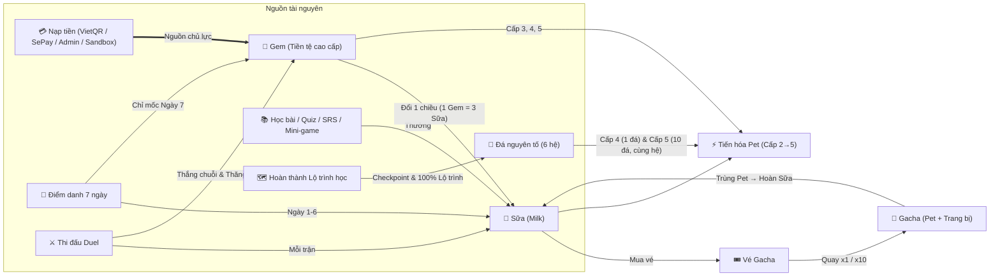

# 🐮 Cowdi English — Kế Hoạch Triển Khai Hệ Thống Kinh Tế & Nuôi Pet v1.0

> **Phiên bản:** v1.0  
> **Phạm vi:** Nạp tiền nhận Gem (Ưu tiên #1), Hệ thống tiền tệ Sữa & Gem, Đá Nguyên Tố, Tiến hóa Pet 5 cấp, Chỉ số chiến đấu ATK/HP, Vòng quay Gacha, Điểm danh 7 ngày & Thu gọn hệ thống  
> **Trạng thái:** Đã duyệt kế hoạch — Sẵn sàng triển khai

---

## 1. Mục tiêu tổng quan

Tái thiết kế toàn bộ vòng lặp kinh tế và nuôi Pet của **Cowdi English** theo mô hình **Freemium chuẩn sản phẩm**, đặt **Nạp tiền nhận 💎 Gem** làm nguồn Gem chủ lực, đồng thời giữ trải nghiệm học tập miễn phí công bằng với lộ trình cày Sữa, Đá nguyên tố và Gem siêu hiếm:

1. **💎 Nạp tiền nhận Gem (Ưu tiên #1)**:
   - Người dùng chọn gói nạp VNĐ → hệ thống sinh đơn hàng `pending` kèm mã **VietQR** tự động điền sẵn số tiền & nội dung chuyển khoản duy nhất (`COWDIXXXXXX`).
   - Hỗ trợ **3 kênh xác nhận cộng Gem an toàn** (dùng MySQL Transaction + `SELECT ... FOR UPDATE`, chống cộng trùng):
     1. **Webhook tự động** (SePay / Casso) — cộng Gem real-time trong vài giây + Web Push Notification.
     2. **Admin duyệt thủ công** ngay trong trang quản trị `/admin` (kèm thống kê doanh thu & quản lý đơn).
     3. **Chế độ Sandbox Demo** (`TOPUP_SANDBOX_MODE=true` hoặc tài khoản Admin) — bấm 1 nút để giả lập thanh toán thành công khi thuyết trình / kiểm thử đồ án.
   - Ghi nhận đầy đủ sổ cái biến động Gem (`gem_transactions`) để đối soát minh bạch mọi lần nạp / thưởng / tiêu.
2. **Thay thế ví XP tiêu dùng bằng 🥛 Sữa (`milk`)**:
   - Mọi hoạt động học tập (bài học, quiz, ôn từ SRS, mini-game, nhiệm vụ ngày, checkpoint, thi đấu Duel) đều thưởng **Sữa**.
   - Sữa dùng để **mua Vé Gacha**, **tiến hóa Pet**, và mua vật phẩm trang trí.
   - *(Chỉ số `total_xp` được giữ ngầm và đồng bộ tăng cùng Sữa học tập để không làm gãy cấp độ CEFR và bảng xếp hạng học viên hiện có).*
3. **Thay thế Coins bằng 💎 Gem (`gems`) — tiền tệ cao cấp / đặc thù**:
   - **Nguồn nhận**: **Nạp tiền (chủ lực)** + 2 nguồn miễn phí siêu hiếm là **Điểm danh mốc ngày 7** và **Thi đấu Duel** (mốc thắng chuỗi & thăng hạng giải đấu). Tuyệt đối không rơi từ học bài thường, nhiệm vụ ngày hay Gacha.
   - **Công dụng**: Chỉ dùng để **tiến hóa Pet cấp 3, 4, 5** và **quy đổi 1 chiều sang Sữa** với tỷ lệ **1 Gem = 3 Sữa**.
4. **Thêm nguyên liệu 🔮 Đá nguyên tố (`elementalStones`)** gồm 6 hệ (`neutral`, `fire`, `water`, `nature`, `earth`, `cosmic`):
   - Là phần thưởng gắn với tiến độ **Lộ trình học** (vượt Checkpoint & hoàn thành 100% lộ trình).
   - Bắt buộc **cùng hệ với Pet** khi tiến hóa lên **Super (cấp 4)** và **Legendary (cấp 5)**.
5. **Cơ chế Tiến hóa Pet chủ động (5 hình thái — 4 mốc tiến hóa)** theo bảng chi phí Sữa + Gem + Đá nguyên tố.
6. **Xây dựng đầy đủ hệ thống Gacha**: Mua **Vé Gacha** bằng Sữa, giao diện quay `x1` / `x10` kèm hiệu ứng mở thẻ, bảo hiểm (Pity 50), pool Pet + trang bị, và tự động hoàn **Sữa** khi quay trùng Pet.
7. **Đổi hệ chỉ số Pet sang chiến đấu (⚔️ ATK & ❤️ HP) và hiển thị Nguyên liệu tiến hóa**:
   - Đổi mục **"Chỉ số gốc"** (4 kỹ năng Nghe/Nói/Đọc/Viết) thành **⚔️ Tấn công (ATK)** và **❤️ HP** tăng theo cấp tiến hóa.
   - Đổi mục **"Kỹ năng hiện tại"** trong **Cowdi Dex** thành **"Nguyên liệu để tiến hóa"** (hiển thị đủ/thiếu Sữa, Gem, Đá cùng hệ + tiến hóa nhanh).
8. **Thu gọn 5 thành phần ít dùng / code chết** để giao diện gọn gàng và dễ bảo trì.

---

## 2. Sơ đồ dòng chảy kinh tế



---

## 3. Bảng thiết kế chi tiết các hệ thống

### 3.1. Hệ thống Nạp tiền nhận Gem (Ưu tiên #1)

| Mã gói | Tên gói | Giá (VNĐ) | Gem gốc | Bonus | Tổng Gem | Gợi ý sử dụng |
|---|---|---:|---:|---:|---:|---|
| `starter` | Gói Khởi Động | **10,000đ** | 10 | +2 (lần đầu) | 10–12 💎 | Trải nghiệm & lên Junior |
| `super_pack` | Gói Tiến Hóa Super | **25,000đ** | 25 | +5 (lần đầu) | 25–30 💎 | Đủ **25 Gem** lên Super ngay |
| `legend_pack` | Gói Huyền Thoại ⭐ | **49,000đ** | 50 | +10 | **60 💎** | Đủ **50 Gem** lên Legendary |
| `master_pack` | Gói Cao Thủ | **99,000đ** | 110 | +25 | **135 💎** | Nuôi nhiều Pet Super/Legendary |
| `vip_pack` | Gói Đại Gia | **199,000đ** | 240 | +60 | **300 💎** | Tối ưu nhất (tiết kiệm 33%) |

**Luồng thanh toán VietQR + Real-time Polling:**
1. Người dùng bấm **"+ Nạp Gem"** (trên thanh HUD, trang Pet khi thiếu Gem, hoặc `/topup` / tab đầu tiên trong Cửa hàng).
2. Chọn gói → Server tạo đơn `pending` (hiệu lực 15 phút), sinh mã đơn `COWDIXXXXXX` và URL ảnh VietQR (`https://img.vietqr.io/image/...`).
3. Giao diện hiển thị mã QR + STK + Chủ TK + Số tiền + Nội dung CK (có nút sao chép từng dòng) + đồng hồ đếm ngược 15 phút.
4. Frontend tự kiểm tra trạng thái đơn mỗi **3 giây** (`GET /api/topup/orders/:code`) → ngay khi **Webhook SePay/Casso** gọi về, **Admin duyệt**, hoặc bấm **🧪 Thanh toán thử (Sandbox Demo)**, giao diện lập tức phát hiệu ứng nhận `+XX 💎 Gem` và cập nhật số dư.

---

### 3.2. Bảng Tiến hóa Pet & Chỉ số chiến đấu (ATK / HP)

| Mốc tiến hóa | Hình thái | 🥛 Sữa | 💎 Gem | 🔮 Đá nguyên tố (cùng hệ) | Hệ số ATK & HP |
|---|---|---:|---:|---:|---:|
| Gốc (Cấp 1) | Stage 0 — Trứng (Egg) | — | — | — | `×1.0` |
| Cấp 1 → 2 | Stage 1 — Baby | **500** | 0 | 0 | `×1.3` |
| Cấp 2 → 3 | Stage 2 — Junior | **1,500** | **1** | 0 | `×1.7` |
| Cấp 3 → 4 | Stage 3 — Super | **5,000** | **25** | **1** | `×2.3` |
| Cấp 4 → 5 | Stage 4 — Legendary | **20,000** | **50** | **10** | `×3.2` |

**Chỉ số chiến đấu (`baseStats: { atk, hp }`) cho 22 Pet trong `PET_REGISTRY`:**
- `starter` (Cowdi): cân bằng `ATK 24 / HP 120`
- `common` (Foxie, Pingu, Leafy, Paddy): `ATK 20–28 / HP 105–145`
- `rare` (Sparky, Mimi, Owlbert, Flippy, Sprout, Mushroom, Radish): `ATK 28–38 / HP 125–160`
- `epic` (Leo, Bamboo, Storm, Shadow, Ginseng, Bun): `ATK 38–48 / HP 165–205`
- `legendary` (Prisma, Draco): `ATK 54–62 / HP 225–250`
- `event` (Pumpkin, Monk): `ATK 38–42 / HP 170–185`
- **Công thức chỉ số hiện tại:** `atk = Math.round(baseAtk * evoMul)`, `hp = Math.round(baseHp * evoMul)`
- **Công thức Power Score mới:** `Power = atk * 3 + Math.round(hp / 2)` (đồng bộ Client & Server `/api/leaderboard`).
- **Cowdi Dex (`CollectionPage`):**
  - Mục **"Chỉ số gốc"** → hiển thị 2 thanh **⚔️ Tấn công (ATK)** và **❤️ HP** (kèm chỉ số thực tế nếu đã tiến hóa).
  - Mục **"Kỹ năng hiện tại"** → thay hoàn toàn thành **"Nguyên liệu để tiến hóa"** (hiển thị Sữa / Gem / Đá cùng hệ đang có vs yêu cầu + nút Tiến hóa nhanh).
- *Lưu ý:* Biểu đồ Radar 4 kỹ năng tiếng Anh của **người học** (`userData.skillXP`) trên `ProgressPage` được giữ nguyên — chỉ chuyển chỉ số của **Pet** sang ATK & HP.

---

### 3.3. Nguồn nhận Đá nguyên tố (6 hệ)

Gồm 6 loại khớp hoàn toàn với `PET_REGISTRY`: `neutral` (⚪ Trung Tính), `fire` (🔥 Lửa), `water` (💧 Nước), `nature` (🌿 Thiên Nhiên), `earth` (🪨 Đất), `cosmic` (🌌 Vũ Trụ).

- **Vượt Checkpoint của 1 Unit (lần đầu đạt ≥70%)**: nhận **+1 Rương Đá Nguyên Tố** (mở ra chọn 1 trong 6 hệ).
- **Hoàn thành 100% cả 1 Lộ trình học** (`general`, `ielts`, `b1`, `b2`, `toeic`, `advanced` — mỗi lộ trình nhận 1 lần): nhận **+10 Rương Đá Nguyên Tố** (đủ 10 đá cùng hệ để lên Legendary).
- *Mục đích:* Với 44 Unit và 6 Lộ trình, cơ chế Rương chọn hệ giúp người chơi không bị kẹt toán học (11 đá/pet) khi nuôi bất kỳ hệ Pet nào mà vẫn gắn chặt với việc hoàn thành lộ trình học.

---

### 3.4. Bảng cân bằng Sữa, Điểm danh, Duel, Quy đổi & Gacha

| Hạng mục | Quy tắc / Số liệu | Ghi chú |
|---|---|---|
| **Học bài / Quiz / SRS / Mini-game** | Thưởng **🥛 Sữa** (mini-game có trần `150 Sữa/ngày`, vượt trần nhận 20%) | Không rơi Gem |
| **Nhiệm vụ ngày & Thành tựu Pet** | `+40 Sữa/nhiệm vụ` (+`80 Sữa` bonus hoàn thành cả 3), `+100 Sữa/thành tựu` | Không rơi Gem |
| **Điểm danh Ngày 1 → 6** | `50 / 75 / 100 / 125 / 150 / 200` Sữa | Xác thực theo ngày giờ VN (`Asia/Ho_Chi_Minh`) |
| **Điểm danh Ngày 7** | **+300 Sữa + 5 💎 Gem** | Nguồn Gem miễn phí ổn định |
| **Duel — Mỗi trận đấu** | Tạo trận `+30 Sữa`; Thắng `+100` / Hòa `+50` / Thua `+25 Sữa` | — |
| **Duel — Thắng chuỗi (siêu hiếm)** | Chuỗi 3: **+2 💎** · Chuỗi 5: **+5 💎** · Chuỗi 10: **+10 💎** | Trần 25 Gem/tuần chống farm/win-trading |
| **Duel — Thăng hạng League** | Bạc **+3 💎** · Vàng **+5 💎** · Kim cương **+10 💎** · Cao thủ **+20 💎** | Nhận 1 lần duy nhất cho mỗi hạng |
| **Quy đổi Gem → Sữa** | **1 Gem = 3 Sữa** (chỉ 1 chiều) | Có cảnh báo xác nhận vì Gem rất hiếm |
| **Giá Vé Gacha** | **300 Sữa / 1 Vé** · **2,700 Sữa / 10 Vé** (giảm 10%) | Mua bằng Sữa |
| **Tỉ lệ Quay Gacha** | Legendary Pet `2%` · Epic Pet `8%` · Rare Pet `20%` · Common Pet `25%` · Trang bị `25%` · Túi Sữa `20%` | **0% rơi Gem** · Quay x10 chắc chắn ≥ Rare · Pity 50 chắc chắn ≥ Epic |
| **Hoàn Sữa khi trùng Pet** | Common `+150` · Rare `+350` · Epic `+800` · Legendary `+2,000 Sữa` | Hiển thị badge `"Trùng → +XXX Sữa"` |

---

### 3.5. Phương án di trú dữ liệu tài khoản cũ (Migration)

- `availableXP` cũ → chuyển **1:1 sang 🥛 Sữa (`milk`)**.
- `coins` cũ → quy đổi **1 Coin = 5 Sữa** (+ tặng **1 Gem khởi đầu** nếu tài khoản từng có `coins > 0` hoặc từng thắng Duel) để không làm mất độ hiếm của Gem.
- **Pet đã tiến hóa trước đây**: giữ nguyên cấp đã đạt bằng công thức `evolution = Math.max(pet.evolution || 0, legacyStageFromXp)` trong lần migrate đầu tiên, đảm bảo không giáng cấp Pet của người chơi cũ.

---

### 3.6. Đề xuất thu gọn 5 phần ít dùng / code chết

| Thành phần hiện tại | Vấn đề trong mã nguồn | Phương án thu gọn |
|---|---|---|
| **1. `WEEKLY_QUESTS`** (`pets.js`, `usePet.jsx`) | Có trong code nhưng chưa từng render ở bất kỳ màn hình nào (dead code). | **Xóa bỏ**, thay bằng **Điểm danh 7 ngày**. |
| **2. Tab "Phòng" (`room`) & "Đồ ăn" (`food`) trong `ShopPage`** | 5 phòng chưa từng vẽ nền ở `PetPage`; tab Đồ ăn có `food_milk` trùng tên tiền tệ Sữa và ăn không trừ số lượng; link `/shop` đang bị comment out trên menu Desktop. | **Gỡ tab Phòng & Đồ ăn**, làm mới `/shop` (bật lại trên menu) gồm: *Nạp Gem*, *Vé Gacha*, *Đổi Gem → Sữa*, *Trang trí & Quà tặng* (mua bằng Sữa). |
| **3. Card "Cho Pet ăn XP"** (`PetPage`) | Không còn dùng cơ chế cho ăn XP để tiến hóa. | **Thay thế** bằng card **"⚡ Tiến hóa Pet"** (Sữa / Gem / Đá cùng hệ) + card **"⚔️ Chỉ số chiến đấu (ATK & HP)"**. |
| **4. 4 thanh `Pet Needs` tự tụt mỗi giờ** | Không còn gắn với tab Đồ ăn, dễ khiến Pet báo ốm vô cớ. | **Thu gọn trên UI** (bỏ 4 thanh chi tiết ở `HomePage`, giữ hiển thị cảm xúc gọn theo hoạt động gần nhất). |
| **5. Thanh HUD & trang Xếp hạng** | HUD cũ hiển thị chồng chéo `Streak + Lv + Xu + Pet`; `/leaderboard` và `/student-ranking` tách rời. | **Gọn hóa HUD** thành `🔥 Streak · 🥛 Sữa · 💎 Gem (+ Nạp) · 📅 Điểm danh · 🐾 Pet`; thống nhất luồng xem Bảng xếp hạng. |

---

## 4. Kiến trúc triển khai & Danh sách File

### 4.1. Cơ sở dữ liệu & Cấu hình (`server/db/`, `server/config/`, `src/data/`)

#### `[NEW]` `server/db/migrate-economy-v2.sql`
Migration idempotent (tương thích MySQL 5.5+):
1. Bổ sung vào `user_progress`:
   - `milk INT UNSIGNED NOT NULL DEFAULT 0`
   - `total_milk_earned INT UNSIGNED NOT NULL DEFAULT 0`
   - `gems INT UNSIGNED NOT NULL DEFAULT 0`
   - `total_gems_earned INT UNSIGNED NOT NULL DEFAULT 0`
   - `gacha_tickets INT UNSIGNED NOT NULL DEFAULT 0`
   - `gacha_pity INT UNSIGNED NOT NULL DEFAULT 0`
   - `elemental_stones LONGTEXT DEFAULT NULL`
   - `checkin_data LONGTEXT DEFAULT NULL`
   - `duel_rewards_claimed LONGTEXT DEFAULT NULL`
2. Tạo bảng `gem_orders`:
   ```sql
   CREATE TABLE IF NOT EXISTS gem_orders (
     id              INT UNSIGNED AUTO_INCREMENT PRIMARY KEY,
     order_code      VARCHAR(32) NOT NULL UNIQUE,
     user_id         INT UNSIGNED NOT NULL,
     package_id      VARCHAR(32) NOT NULL,
     amount_vnd      INT UNSIGNED NOT NULL,
     gems_base       INT UNSIGNED NOT NULL,
     gems_bonus      INT UNSIGNED NOT NULL DEFAULT 0,
     gems_total      INT UNSIGNED NOT NULL,
     payment_method  ENUM('vietqr', 'sandbox') NOT NULL DEFAULT 'vietqr',
     status          ENUM('pending', 'paid', 'expired', 'cancelled') NOT NULL DEFAULT 'pending',
     provider_tx_id  VARCHAR(128) DEFAULT NULL UNIQUE,
     paid_by         VARCHAR(64) DEFAULT NULL,
     paid_at         DATETIME DEFAULT NULL,
     expires_at      DATETIME NOT NULL,
     created_at      TIMESTAMP NOT NULL DEFAULT CURRENT_TIMESTAMP,
     CONSTRAINT fk_gem_orders_user FOREIGN KEY (user_id) REFERENCES users(id) ON DELETE CASCADE,
     INDEX idx_gem_orders_user (user_id, status),
     INDEX idx_gem_orders_status_exp (status, expires_at)
   ) ENGINE=InnoDB DEFAULT CHARSET=utf8mb4 COLLATE=utf8mb4_unicode_ci;
   ```
3. Tạo bảng `gem_transactions` (sổ cái lịch sử biến động Gem):
   ```sql
   CREATE TABLE IF NOT EXISTS gem_transactions (
     id            INT UNSIGNED AUTO_INCREMENT PRIMARY KEY,
     user_id       INT UNSIGNED NOT NULL,
     delta         INT NOT NULL,
     balance_after INT UNSIGNED NOT NULL,
     source        VARCHAR(32) NOT NULL,
     ref_id        VARCHAR(64) DEFAULT NULL,
     note          VARCHAR(255) DEFAULT NULL,
     created_at    TIMESTAMP NOT NULL DEFAULT CURRENT_TIMESTAMP,
     CONSTRAINT fk_gem_tx_user FOREIGN KEY (user_id) REFERENCES users(id) ON DELETE CASCADE,
     INDEX idx_gem_tx_user (user_id, created_at)
   ) ENGINE=InnoDB DEFAULT CHARSET=utf8mb4 COLLATE=utf8mb4_unicode_ci;
   ```
4. Backfill an toàn cho tài khoản hiện có (`milk = available_xp`, `total_milk_earned = total_xp`).

#### `[MODIFY]` `server/db/schema.sql` & `server/.env.example`
- Đồng bộ `schema.sql` với các cột và bảng mới.
- Thêm vào `.env.example`: `VIETQR_BANK_ID`, `VIETQR_ACCOUNT_NO`, `VIETQR_ACCOUNT_NAME`, `VIETQR_TEMPLATE`, `TOPUP_WEBHOOK_SECRET`, `TOPUP_SANDBOX_MODE=true`.

#### `[NEW]` `server/config/economy.js` & `src/data/economy.js`
Tập trung toàn bộ hằng số kinh tế (đồng bộ giữa Backend & Frontend): `TOPUP_PACKAGES`, `GEM_TO_MILK_RATE`, `EVOLUTION_COSTS`, `ELEMENTAL_STONES`, `GACHA_TICKET_PRICE`, `GACHA_TICKET_10_PRICE`, `GACHA_PITY_LIMIT`, `DUPLICATE_PET_MILK_REFUND`, `CHECKIN_REWARDS`, `DUEL_STREAK_GEM_REWARDS`, `DUEL_LEAGUE_GEM_REWARDS`.

---

### 4.2. Backend API (`server/routes/`, `server/utils/`)

#### `[NEW]` `server/routes/topup.js` (mount tại `/api/topup` trong `server/index.js`)
- Hàm atomic `fulfillGemOrder(...)`: khóa đơn `FOR UPDATE`, kiểm tra `status === 'pending'` & số tiền, cộng `gems` + `total_gems_earned`, ghi `gem_transactions`, gửi Web Push Notification.
- **User endpoints:**
  - `GET /api/topup/packages`
  - `POST /api/topup/orders` (tạo đơn + sinh URL VietQR, hạn 15 phút)
  - `GET /api/topup/orders` (lịch sử đơn + sổ cái `gem_transactions`)
  - `GET /api/topup/orders/:code` (polling trạng thái)
  - `POST /api/topup/orders/:code/cancel`
  - `POST /api/topup/orders/:code/sandbox-pay` (chỉ bật khi `TOPUP_SANDBOX_MODE=true` hoặc Admin)
- **Webhook endpoints:**
  - `POST /api/topup/webhook/sepay` (xác thực `Authorization: Apikey <TOPUP_WEBHOOK_SECRET>`)
  - `POST /api/topup/webhook/casso` (xác thực header `secure-token`)

#### `[MODIFY]` `server/routes/admin.js`
- `GET /api/admin/topup/orders?status=pending|paid|all` — danh sách đơn nạp + KPI doanh thu hôm nay / 30 ngày / toàn thời gian.
- `POST /api/admin/topup/orders/:id/approve` — Admin duyệt tay đơn chuyển khoản (atomic).
- `POST /api/admin/topup/orders/:id/reject` — Admin từ chối đơn.
- `POST /api/admin/topup/grant` — Admin cấp Gem trực tiếp theo email/userId (ghi sổ cái).

#### `[MODIFY]` `server/routes/api.js`
- Mở rộng `GET /api/pet-data` trả đầy đủ kinh tế mới; bảo vệ `PUT /api/pet-data` **không cho phép client ghi đè trực tiếp `gems`**.
- Thêm các endpoint xác thực phía server:
  - `GET /api/checkin` & `POST /api/checkin`
  - `POST /api/economy/exchange` (đổi `1 Gem → 3 Sữa`)
  - `POST /api/gacha/buy-ticket` & `POST /api/gacha/pull`
  - `POST /api/pet/evolve`
  - `POST /api/stones/claim` & `POST /api/stones/open-chest`
  - `POST /api/duel/ack-rewards`
- Cập nhật `POST /api/duel/:id/join` tự kiểm tra & cộng Gem chuỗi thắng / thăng hạng League cho cả Challenger & Opponent.
- Cập nhật `parsePetSummary` & `GET /api/leaderboard` dùng `pet.evolution` và công thức Power Score theo **ATK / HP**.

#### `[MODIFY]` `server/utils/pet-icon.js`
- Đọc `pet.evolution` thay vì `pet.totalXpEarned` và sửa lookup `pet.speciesId`.

---

### 4.3. Dữ liệu Pet, Hooks & Âm thanh (`src/data/`, `src/hooks/`)

- **`[MODIFY]` `src/data/pets.js`**:
  - Chuyển `baseStats` của toàn bộ 22 Pet sang `{ atk, hp }`.
  - Thêm `EVOLUTION_STAT_MULTIPLIER = [1.0, 1.3, 1.7, 2.3, 3.2]`, `getPetCombatStats(speciesId, stage)`, `getPetEvolutionByStage`, `resolvePetEvolution`.
  - Cập nhật `calculatePowerScore`, xóa `WEEKLY_QUESTS`, gỡ `room` & `food` khỏi `SHOP_ITEMS`, chuyển giá Shop & thưởng Quest/Achievement sang **Sữa**.
- **`[MODIFY]` `src/hooks/useUser.jsx`**: Giữ `totalXP` nội bộ đồng bộ với điểm học tập.
- **`[MODIFY]` `src/hooks/usePet.jsx`**: Quản lý đầy đủ `milk`, `gems`, `gachaTickets`, `gachaPity`, `elementalStones`, `checkinData`, `duelNotifications`; migration tự động 1 lần cho user cũ; tắt tự động tiến hóa theo XP; cung cấp đầy đủ action APIs.
- **`[MODIFY]` `src/hooks/useSound.jsx`**: Thêm âm thanh `gachaSpin`, `gachaRare`, `gachaLegend`, `checkin`, `topupSuccess`.

---

### 4.4. Giao diện người dùng (`src/components/`, `src/features/`, `src/pages/`, `src/styles/`)

- **`[MODIFY]` `src/components/Icon.jsx`**: Thêm 3 icon SVG kawaii: `milk`, `ticket`, `stone`.
- **`[NEW]` `src/features/economy/TopUpPage.jsx` & `src/pages/TopUpPage.jsx`**: Trang Nạp Gem (`/topup`) với 5 gói nạp, hộp thanh toán VietQR (QR + sao chép + đếm ngược + polling 3s + nút Sandbox Demo), và lịch sử đơn + sổ cái Gem.
- **`[NEW]` `src/features/economy/DailyCheckInModal.jsx`**: Modal Điểm danh 7 ngày (ngày 1–6 Sữa, ngày 7 **💎 +5 Gem**).
- **`[NEW]` `src/features/economy/GemExchangeModal.jsx`**: Modal đổi **1 Gem → 3 Sữa** kèm cảnh báo độ hiếm Gem & nút Nạp Gem.
- **`[NEW]` `src/features/economy/StoneChestModal.jsx`**: Modal mở Rương Đá Nguyên Tố chọn 1 trong 6 hệ (hiển thị Pet cùng hệ user đang có).
- **`[NEW]` `src/features/pet/GachaPage.jsx` & `src/pages/GachaPage.jsx`**: Trang Quay Gacha (`/gacha`) với mua vé (1/10 vé), thanh Pity `X/50`, bảng tỉ lệ rơi, quay `x1` / `x10` kèm hiệu ứng mở thẻ & hoàn Sữa khi trùng Pet.
- **`[MODIFY]` `src/features/pet/CollectionPage.jsx` & `src/styles/dex.css`**:
  - Mục **"Chỉ số gốc"** → 2 thanh **⚔️ Tấn công (ATK)** & **❤️ HP**.
  - Mục **"Kỹ năng hiện tại"** → đổi thành **"Nguyên liệu để tiến hóa"** (Sữa / Gem / Đá cùng hệ + nút Tiến hóa ngay).
  - Mục **"Tiến hoá"** → hiển thị theo `pet.evolution`.
- **`[MODIFY]` `src/features/pet/PetPage.jsx`**: Thay *"Cho Pet ăn XP"* bằng **"⚡ Tiến hóa Pet"** (có nút dẫn sang Nạp Gem / Mở Rương Đá), thay *"Kỹ năng"* bằng **"⚔️ Chỉ số chiến đấu (ATK & HP)"**, thêm kho tài nguyên & lối tắt Điểm danh / Gacha.
- **`[MODIFY]` `src/features/pet/ShopPage.jsx`**: Làm mới còn 4 tab: *💎 Nạp Gem*, *🎟️ Vé Gacha*, *🔄 Đổi Gem → Sữa*, *🎩 Trang trí & Quà tặng* (bỏ Phòng & Đồ ăn).
- **`[MODIFY]` `src/pages/AdminPage.jsx`**: Thêm tab **"💎 Nạp Gem & Doanh thu"** (KPI doanh thu, duyệt/từ chối đơn `pending`, cấp Gem nhanh).
- **`[MODIFY]` `src/components/layout/BookShell.jsx`, `src/App.jsx`, `src/data/seo-config.js`**: Gọn hóa HUD (`🔥 Streak · 🥛 Sữa · 💎 Gem (+ Nạp) · 📅 Điểm danh · 🐾 Pet`), bật lại `/shop`, thêm route `/topup` và `/gacha`.
- **`[MODIFY]` Các trang thưởng học tập & thống kê**:
  - `src/pages/LearningPathPage.jsx`: Thưởng Sữa + Rương Đá Nguyên Tố tại Checkpoint & khi hoàn thành 100% lộ trình.
  - `src/features/duel/DuelPage.jsx`: Thưởng Sữa theo trận + hiển thị HP/ATK thật của Pet + tiến độ nhận Gem chuỗi thắng & thăng hạng League.
  - `src/features/lesson/LessonDetailPage.jsx`, `src/features/practice/PracticePage.jsx`, `src/features/mini-games/MiniGamePage.jsx`, `src/features/review/ReviewPage.jsx`: Chuyển thưởng sang **🥛 Sữa**.
  - `src/pages/HomePage.jsx`, `src/pages/AccountPage.jsx`, `src/pages/ProgressPage.jsx`, `src/pages/LeaderboardPage.jsx`, `src/pages/StudentRankingPage.jsx`: Đồng bộ hiển thị Sữa, Gem, Đá, ATK/HP Pet và thu gọn hiển thị thừa.

---

## 5. Kế hoạch kiểm thử (Verification Plan)

### 5.1. Kiểm thử tự động
1. **Frontend production build**:
   ```powershell
   npm run build
   ```
   Xác minh không có lỗi biên dịch và không còn reference chết (`feedXPToPet`, `addCoins`, `WEEKLY_QUESTS`).
2. **Backend syntax check**:
   ```powershell
   node --check server/index.js
   node --check server/routes/api.js
   node --check server/routes/topup.js
   node --check server/routes/admin.js
   node --check server/config/economy.js
   node --check server/utils/pet-icon.js
   ```
3. **Unit test logic kinh tế**:
   - Kiểm tra gói nạp `TOPUP_PACKAGES`, tính bonus lần đầu, parse mã đơn `COWDIXXXXXX` từ nội dung CK VietQR/SePay/Casso.
   - Kiểm tra chi phí tiến hóa 4 cấp (`500 Sữa` → `1,500 Sữa + 1 Gem` → `5,000 Sữa + 25 Gem + 1 Đá cùng hệ` → `20,000 Sữa + 50 Gem + 10 Đá cùng hệ`) và chặn dùng Đá sai hệ.
   - Kiểm tra công thức tăng trưởng **ATK & HP** qua 5 cấp (`×1.0 → ×3.2`) và `calculatePowerScore`.
   - Kiểm tra đổi `1 Gem = 3 Sữa`, engine Gacha (0% Gem, x10 ≥ Rare, Pity 50, hoàn Sữa khi trùng Pet), và Điểm danh 7 ngày (chỉ ngày 7 nhận Gem).

### 5.2. Kiểm thử thủ công trên trình duyệt
1. **Luồng Nạp Gem (Ưu tiên #1)**:
   - Tạo đơn tại `/topup` → kiểm tra mã VietQR, nội dung CK `COWDIXXXXXX`, bộ đếm 15 phút.
   - Test **Sandbox Demo** → polling tự phát hiện `paid`, cộng đúng Gem + bonus và ghi sổ cái `gem_transactions`.
   - Test **Admin duyệt thủ công** tại `/admin` → đơn chuyển `paid`, user nhận Gem, KPI doanh thu cập nhật.
   - Test **Webhook SePay** (giả lập `curl`): sai secret bị `401`, đúng secret cộng Gem, gửi lặp `provider_tx_id` không bị cộng 2 lần.
2. **Cowdi Dex, Chỉ số ATK/HP, Đá nguyên tố & Tiến hóa Pet**:
   - Kiểm tra `/collection`: mục **Chỉ số gốc** hiển thị **⚔️ Tấn công (ATK)** & **❤️ HP**; mục bên dưới là **Nguyên liệu để tiến hóa**.
   - Vượt Checkpoint nhận & mở Rương Đá → tiến hóa qua 4 cấp (`Baby → Junior → Super → Legendary`), kiểm tra ATK/HP tăng đúng hệ số và nút dẫn sang `/topup` khi thiếu Gem.
3. **Điểm danh 7 ngày & Đổi Gem → Sữa**: Ngày 1–6 chỉ nhận Sữa, ngày 7 nhận `+5 Gem`; đổi Gem đúng tỷ lệ `1:3` có cảnh báo.
4. **Vé Gacha & Quay Gacha x1 / x10**: Mua vé bằng Sữa, quay x1/x10, Pet mới vào `CollectionPage`, Pet trùng hoàn Sữa.
5. **Thi đấu Duel**: Thắng chuỗi / thăng hạng League nhận đúng Gem & hiện thông báo thưởng.
6. **Migration & Responsive**: Dữ liệu cũ không mất cấp Pet; giao diện HUD và các modal hiển thị gọn trên cả Desktop và Mobile.
