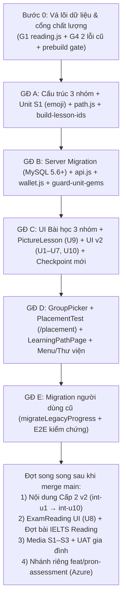

# SPMP-UPGRADE-CONTENT-LEARNING-GROUPS — Kế hoạch Hợp nhất Nâng cấp Lộ trình 3 Nhóm & Chuẩn Nội dung v2

> **Mã tài liệu:** SPMP-UPGRADE-CONTENT-LEARNING-GROUPS · **Chuẩn tham chiếu:** IEEE 16326:2019 · **Phiên bản:** 1.0 · **Trạng thái:** Approved · **Ngày lập:** 2026-11-24
> **Nguồn sự thật kết hợp:**
> 1. [SRS-LESSON-3-LEVELS-v1.0.md](../02-requirements/SRS-LESSON-3-LEVELS-v1.0.md) — Yêu cầu nội dung 3 cấp
> 2. [SDD-LEARNING-GROUPS-v2.0.md](../04-design/SDD-LEARNING-GROUPS-v2.0.md) — Thiết kế kỹ thuật tách 3 nhóm + migration
> 3. [STD-LESSON-CONTENT-v1.0.md](../05-implementation/content/STD-LESSON-CONTENT-v1.0.md) & [MAP-CURRENT-UI.md](../05-implementation/content/MAP-CURRENT-UI.md) — Bộ chuẩn nội dung v1.0 & 10 hạng mục UI (`U1–U10`)

## Lịch sử sửa đổi

| Phiên bản | Ngày | Nội dung | Người thực hiện |
|---|---|---|---|
| 1.0 | 2026-11-24 | Hợp nhất kế hoạch nâng cấp Lộ trình 3 nhóm (GĐ A–E) + Chuẩn nội dung v2 (`U1–U10`, vá lỗi lõi dữ liệu) kèm bảng đối chiếu toàn bộ khoảng trống với code hiện tại | Sonny + AI |

---

## 1. Quyết định đã chốt của Product Owner (2026-11-24)

1. **Tái cấu trúc lộ trình 3 nhóm kèm migration dữ liệu**: bỏ `general`, chuyển sang 3 nhóm (`beginner` · `intermediate` + `advanced` · `exam`) theo [SDD-LEARNING-GROUPS-v2.0.md](../04-design/SDD-LEARNING-GROUPS-v2.0.md); chạy đồng bộ migration DB (`migrate-learning-groups.sql` + Node runner), `migrateLegacyProgress()` phía client và `guard-unit-gems.mjs` phía server để không mất tiến độ và không cấp đúp Gem.
2. **Bài Starter tính mốc Gem/Đá như bài thường**: giữ nguyên công thức `shared/game-config.js` (`2 bài mới = 1 Gem`, `10 bài mới = 1 Đá`), khớp quyết định `L8`.
3. **Ba quyết định nội dung 3 cấp**: bỏ chấm phát âm khỏi Cấp 1 & Cấp 2; toàn bộ bài cũ xếp từ Cấp 2 trở lên; phát âm chuẩn (`exam-pron` + chấm mức âm vị) dành riêng cho Cấp 3.

---

## 2. Kết quả so khớp mã nguồn hiện tại & các vấn đề cần xử lý

Ngoài 8 vấn đề lộ trình (`H1–H8` trong `SDD-LEARNING-GROUPS v2.0`) và 10 hạng mục UI (`U1–U10` trong `MAP-CURRENT-UI.md`), kiểm toán mã nguồn hiện tại phát hiện thêm các lỗi/xung đột kỹ thuật sau phải vá trong quá trình triển khai:

| Mã | Mức | Vấn đề thực tế trong code hiện tại | File / Dòng | Giai đoạn xử lý |
|---|---|---|---|---|
| **G1** | **P0** | `buildPassage()` trong `reading.js` trả về object mới **không spread `...r`**, làm **mất sạch** `paragraphs`, `glossary`, `paraphrasePairs`, `examQuestions`, `timeLimitMin` của mọi bài v2 đi qua `withReading()`. | `src/data/lessons/reading.js#L70-L84` | **Đợt 0 (trước GĐ A/C)** |
| **G2** | **P0** | Flashcard gọi `translateEnToVi(ex)` chưa từng định nghĩa/import → `ReferenceError` khi lật thẻ (`U1`, `RK-009`). | `src/features/lesson/LessonDetailPage.jsx#L1368, L1428` | **Đợt 0 / GĐ C** |
| **G3** | **P1** | `src/data/lessons/index.js` chưa có track `starter`, chưa bọc `toLegacyShape()`. `useUser.jsx#L671` (`markLessonCompleted`) chỉ tìm trong `LESSONS` (`general`) nên xong bài `exam`/`starter` không tự nạp SRS. Nhiều trang (`VocabularyPage`, `ReviewPage`, `PracticePage`, `MiniGamePage`, `TyperShark`) chỉ import `LESSONS`. | `src/data/lessons/index.js`, `src/hooks/useUser.jsx#L671` | **GĐ A + GĐ C** |
| **G4** | **P1** | 2 lỗi cấu trúc dữ liệu cũ chặn `validate-lessons.mjs`: `ielts-pre-grammar` trùng `"Whose"` (`vocabulary[7]`); `ielts-pre-writing` `quiz[4]` lặp `"paragraph"`. | `src/data/lessons/ielts/ielts-pre-grammar.js`, `ielts-pre-writing.js` | **Đợt 0** |
| **G5** | **Cao** | **Tương thích MySQL < 5.6.5 trên Production (`RK-005`)**: `migrate-learning-groups.sql` dùng `DELIMITER $$` không chạy trực tiếp qua `mysql2` hoặc một số giao diện phpMyAdmin → cần kèm **Node migration runner** (`scripts/run-learning-groups-migration.js`) giống GĐ1/GĐ3 và kiểm tra `deploy.ps1` copy đủ `scripts/`. | `server/db/`, `scripts/`, `deploy.ps1` | **GĐ B** |
| **G6** | **Trung bình** | **Lỗ hổng farm XP Reading (`U10`) & sai hiển thị XP Nghe câu**: `ReadingPassage.submitQuiz` chỉ giữ `rewarded` ở state (nhánh `>=50%` còn không check `!rewarded` → farm `+5 XP` vô hạn); `listenDone` in `+{listenQs.length * 2} XP` nhưng thực tế cộng `listenScore * 3 + bonus`. | `src/features/lesson/LessonDetailPage.jsx#L258, L295-L303, L932-L934, L1796` | **GĐ C** |
| **G7** | **Trung bình** | **Xung đột UX Quiz khi thêm `explanation` (`U3`) và `audioText` (`U6`)**: `handleAnswer` tự nhảy câu sau 1.2s (không kịp đọc giải thích); `useEffect` auto-TTS đọc `q.question` tiếng Việt thay vì `q.audioText` tiếng Anh. | `src/features/lesson/LessonDetailPage.jsx#L982-L991, L1013-L1022` | **GĐ C** |
| **G8** | **Trung bình** | **Đồng nhất schema Starter giữa 2 tài liệu**: `SRS-LESSON-3-LEVELS` §2.3 nêu mẫu tối giản, còn `STD-LESSON-CONTENT-v1.0` §3 bắt buộc thêm `contentVersion: 2`, `unit`, `description`, `instructionsVi` (6 bước), `parentTip`. Khi soạn 4 bài Unit S1 phải tuân thủ đầy đủ `STD v1.0` để validator 0 lỗi. | `src/data/lessons/starter/*.js`, `src/data/lessons/schema.js` | **GĐ A** |
| **G9** | **Trung bình** | `standards.js` chưa có nhánh `track === 'starter'`; header `LessonDetailPage#L1268` gán nhầm `level: 'starter'` thành nhãn `"🔴 Nâng cao"`; `HomePage.jsx#L76` hardcode `getPathById('general')`. | `standards.js`, `LessonDetailPage.jsx`, `HomePage.jsx` | **GĐ A + GĐ D** |
| **G10** | **Vận hành** | Chưa tạo 3 thư mục media `public/image/words/`, `public/image/scenes/`, `public/audio/words/`; cần cấu hình Workbox `runtimeCaching` trong `vite.config.prod.js` cho ảnh cấp 1 để không làm phình PWA precache (hiện 293 entries). | `vite.config.prod.js`, `public/` | **Đợt Media S1–S3** |

---

## 3. Lộ trình triển khai hợp nhất (6 bước tuần tự — tách rạch ròi Code & Nội dung)

### Bước 0 — Vá lõi dữ liệu & Khoá cổng Validator (Nhánh `fix/lesson-foundation` hoặc commit đầu của `feat/learning-groups`)
- Sửa `src/data/lessons/reading.js`: spread `...r` trong `buildPassage()` (`G1`).
- Sửa 2 lỗi cấu trúc trong `ielts-pre-grammar.js` và `ielts-pre-writing.js` (`G4`).
- Thêm test hồi quy bảo toàn trường v2 qua `withReading` trong `shared/lesson-schema.test.js`.
- Thêm `"validate:lessons": "node scripts/validate-lessons.mjs"` và gắn vào `"prebuild"` trong `package.json`.
- **Tiêu chí xong**: `node scripts/validate-lessons.mjs` = **0 lỗi** (exit 0); `npm test` PASS 100%; `npm run build` PASS.

### GĐ A — Dữ liệu & Luật Lộ trình 3 Nhóm (Commit 1 trên `feat/learning-groups`)
- Tạo `src/data/config/groups.js` (`LEARNER_GROUPS`, `getGroup`, `getGroupOfPath`).
- Tạo `src/data/lessons/starter/` gồm 4 bài Unit S1 (`s1-hello`, `s1-me`, `s1-num-1`, `s1-num-2`) dùng emoji + đầy đủ trường `contentVersion: 2` (`STD v1.0`), và `src/data/lessons/starter/index.js`.
- Cập nhật `src/data/lessons/index.js` (thêm `STARTER_LESSONS`, track `starter`, chạy `toLegacyShape` cho bài v2 khi cần tương thích) và `src/data/lessons/standards.js` (nhánh `starter → A1`).
- Thay `src/data/config/units.js` (`BEGINNER_UNITS` S1–S10 với S2–S10 `comingSoon: true`, `INTERMEDIATE_UNITS` `int-u1..10`, `EXAM_INTRO_UNIT`, `EXAM_PRON_UNIT`, giữ `UNITS` tương thích ngược).
- Cập nhật `src/data/lessons/paths.js`: chèn `exam-intro`, `exam-pron`, `requiredUnits`, bổ sung 3 unit IELTS (`ielts-unit-topics-1..3`, 30 bài).
- Viết lại `src/data/path.js` (trạng thái `done/current/open/placed/locked`, `buildPathNodes`, `getLessonAccess`, `getNextPathLesson`, `estimateLessonMilk`).
- Nâng cấp `scripts/build-lesson-ids.mjs`: khử trùng `unitId` (`exam-intro`, `exam-pron` mỗi unit xuất hiện đúng 1 lần kèm `pathIds`), kiểm tra **0 bài mồ côi** & **0 `unitId` trùng khác định nghĩa**.
- **Test mới**: `shared/learning-path.test.js` (5 kịch bản nghiệm thu theo `SDD-LEARNING-GROUPS` §8 GĐ A).

### GĐ B — Backend, Migration MySQL 5.6+ & Chống cấp đúp Gem (Commit 2)
- Tạo `server/db/migrate-learning-groups.sql` (thêm 4 cột `learner_group`, `active_path`, `lesson_scores`, `placement` dùng `LONGTEXT` tương thích MySQL 5.5/5.6+) và `scripts/run-learning-groups-migration.js` (Node runner idempotent).
- Cập nhật `server/routes/api.js`: `GET/PUT /api/progress` hỗ trợ 4 trường mới, validate whitelist, gộp `lesson_scores` theo **max từng khoá** với DB trước khi truyền vào `grantLessonAndUnitRewards`; lọc bỏ dòng `amount = 0` ở mọi truy vấn lịch sử ví.
- Cập nhật `server/utils/wallet.js`: sửa `H6/H7` (`unit_complete` chỉ cấp khi xong hết bài + qua checkpoint thật `source: 'checkpoint'`; `unit_perfect` khi mọi `lessonScores[id] >= 100` và `cp.score === cp.total`).
- Tạo `server/scripts/guard-unit-gems.mjs` (idempotent, chèn dòng 0 Gem cho unit mới mà user cũ đã hoàn thành toàn bộ bài).
- **Test mới**: `server/tests/learning-groups.test.mjs` (5 kịch bản theo `SDD-LEARNING-GROUPS` §8 GĐ B).

### GĐ C — Trải nghiệm Bài học 3 Nhóm, `PictureLesson` & Nâng cấp UI v2 (`U1–U7`, `U9`, `U10`) (Commit 3)
- Tách `generateQuizFromLesson` ra `src/utils/quiz-gen.js` để dùng chung cho Quiz bài học và Checkpoint; áp dụng **U2** (ưu tiên 100% `lesson.quiz` khi `contentVersion === 2`).
- Xây `src/features/lesson/PictureLesson.jsx` (**U9** — 6 bước `look → listen → match → pattern → repeat → challenge`, chữ ≥28px, nút ≥56px, không IPA, nút loa giọng Việt cho hướng dẫn, thử thách ≥4/6 đạt).
- Nâng cấp `src/features/lesson/LessonDetailPage.jsx`:
  - Chuyển sang `PictureLesson` khi `lesson.format === 'picture'`.
  - Áp dụng luật nhóm (phần bắt buộc / tuỳ chọn, `vocabBatchSize = 10`, `ttsRate`, `speak` bắt buộc cho `exam-pron` & Speaking thi, "Làm thử trước" cho Luyện thi, ngưỡng đạt `lessonPassRate` + màn kết quả chưa đạt + ghi `lessonScores`).
  - Thực hiện đồng bộ **U1** (xoá `translateEnToVi`, dùng `exampleVi`), **U3** (hiện `explanation` + nút "Câu tiếp theo →"), **U4** (`pre-line` + nhãn đoạn A–E), **U5** (highlight cụm từ dài nhất trước), **U6** (`audioText` câu listening), **U7** (`pos`, `exampleVi` ở Vocab & Speak, `mistakes[]` ở Grammar, `objectives[]`), **U10** (khoá farm XP Reading + sửa hiển thị XP Nghe câu) và nhãn level `starter`.
- Sửa `src/hooks/useUser.jsx`: thêm 4 trường vào `userData`, sửa `saveCheckpointScore` theo luật ưu tiên `checkpoint > placement/legacy`, sửa `markLessonCompleted` tra cứu trên `ALL_LESSONS`.
- Viết lại `buildCheckpointQuestions` (**H5**) dùng `quiz-gen.js` (chỉ lấy câu trong unit, rải đều bài, bỏ `QUIZ_BANK` khớp chuỗi) + UI kiểm tra unit (đồng hồ 45s cho Luyện thi, modal xác nhận thoát, hiện đáp án đúng + `explanation`).
- **Kiểm chứng**: chạy `node scripts/check-lesson-ui-compat.mjs` xác nhận `greetings` v2 & `s1-pets` đạt yêu cầu; unit test cho `buildCheckpointQuestions`.

### GĐ D — Chọn Nhóm, Kiểm tra Đầu vào, Trang Lộ trình & Điều hướng (Commit 4)
- Tạo `src/features/onboarding/GroupPicker.jsx` (3 thẻ nhóm, chọn kỳ thi cho Luyện thi, gợi ý cho user cũ, nút làm kiểm tra 5 phút).
- Tạo `src/features/placement/PlacementTest.jsx` & route `/placement` (3 tầng A/B/C × 6 câu, đạt ≥5/6 lên tầng, ghi `placed` không đè `checkpoint` thật, không thưởng Sữa/Gem).
- Cập nhật `src/pages/LearningPathPage.jsx`, `src/pages/HomePage.jsx` (bỏ hardcode `general`), `src/components/layout/BookShell.jsx` (gom 1 mục "Luyện thi"), `src/pages/LessonsPage.jsx` (lọc theo nhóm, khoá theo `getLessonAccess`), `src/pages/AccountPage.jsx` (nút "Đổi nhóm học").
- Kiểm tra hiển thị điện thoại **375 px** không cuộn ngang.

### GĐ E — Chuyển đổi Người dùng cũ & Hoàn tất PR chính (Commit 5)
- Cài đặt `migrateLegacyProgress(userData)` trong `src/data/path.js` + gọi 1 lần khi tải progress từ server; gợi ý nhóm theo mục 6.2.
- Kiểm thử E2E kịch bản user cũ đã xong `unit-3` (`greetings`, `family`, `colors`, `numbers`) → mở `int-u2`, gợi ý Trung bình, Gem không tăng.
- Chạy toàn bộ `npm test` + `npm run build` + `npm run build:prod`.
- **Thứ tự deploy Production bắt buộc** (ghi rõ trong PR & Runbook):
  1. Chạy `node scripts/run-learning-groups-migration.js` (migration DB thêm 4 cột).
  2. Deploy mã nguồn mới (server + `dist-prod/` + `shared/lesson-ids.json` + `shared/units.json`).
  3. Chạy `node server/scripts/guard-unit-gems.mjs` (chặn cấp đúp Gem cho unit mới).

### Các đợt tiếp nối sau khi hợp nhất `feat/learning-groups` vào `main`
1. **Nội dung Cấp 2 v2 (mỗi PR 1 unit)**: bắt đầu từ `int-u1` (đưa `_golden/greetings.js` vào `general/greetings.js`, nâng cấp `family`, `colors`, `numbers` theo `briefs/int-u1.md`), tiếp theo `int-u2`, `int-u3` và các bài mỏng nhất theo `RPT-LESSON-CONTENT-2026-11-24.md`.
2. **Màn hình Exam Reading (`U8`) & đợt bài Cấp 3**: tạo `src/features/lesson/ExamReading.jsx` (chia đôi màn hình, đồng hồ `timeLimitMin`, cột từ `glossary`, đủ 6 dạng đề gồm `sentence-completion` & `matching-info`, nút "Xem bằng chứng" tô `evidence.quote`, bảng `paraphrasePairs`), đưa `_golden/ielts-read-rooftop-farms.js` vào lộ trình `ielts`.
3. **Media Starter S1–S3 & UAT**: tạo ~80 ảnh + ~90 file audio cho S1–S3, cấu hình Workbox `runtimeCaching` (`G10`), đăng ký `REG-IMAGE-CATALOG.md`, thử nghiệm 10–20 gia đình trước khi sản xuất S4–S10.
4. **Chấm phát âm mức âm vị (`feat/pron-assessment`)**: nhánh riêng tích hợp Azure AI Speech Pronunciation Assessment (`POST /api/pron/assess`, hạn mức ngày/tháng) + soạn 5 bài `pron-*` mới có giáo viên duyệt.

---

## 4. Liên kết tài liệu & Tiêu chí nghiệm thu chung

- **Tiến độ chi tiết**: theo dõi tại mục **"Lộ trình 3 nhóm"** sẽ mở trong `TASK.md` khi bắt đầu code (theo `SDD-LEARNING-GROUPS` §8) và mảng **WS-5** trong [LOG-PROGRESS.md](LOG-PROGRESS.md).
- **Không phá vỡ Kinh tế v2**: toàn bộ test cũ (91/91) + test mới (`learning-path.test.js`, `learning-groups.test.mjs`) đạt 100%; không đổi `shared/game-config.js`; không xoá dữ liệu `checkpointScores`, `completedLessons`, `wallet_ledger`.
