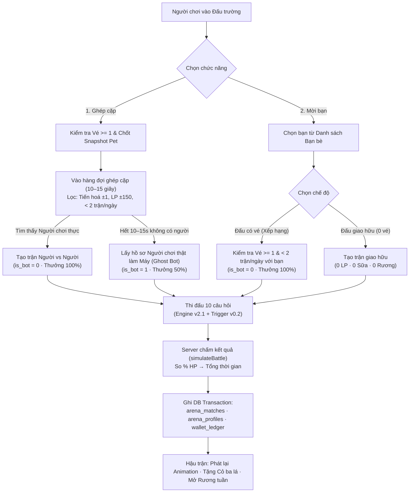

# PROC-ARENA-PVP-WORKFLOW — Quy trình Nghiệp vụ Triển khai Đấu trường (PvP)

> **Phiên bản:** 1.0 · **Ngày lập:** 2026-11-26 · **Trạng thái:** Approved
> **Liên kết đặc tả:** [SRS-ARENA-PVP-RULES-v1.0.md](SRS-ARENA-PVP-RULES-v1.0.md) · [SDD-ECONOMY-BATTLE-v2.1.md](../04-design/SDD-ECONOMY-BATTLE-v2.1.md)

---

## 1. Sơ đồ tổng quan Quy trình Đấu trường

---

## 2. Quy trình 1 — Ghép cặp Ngẫu nhiên (Matchmaking 10–15s)

### Bước 1: Kiểm tra điều kiện đầu vào
1. Client tải hồ sơ Đấu trường (`GET /api/arena/profile`), kiểm tra số **Vé đấu ≥ 1** (nếu hết vé, gợi ý học bài mới / hoàn thành unit để nhận thêm vé).
2. Chốt **Snapshot Pet** đang xuất chiến (`speciesId`, `evolution`, `skills`, `element`, `group`, `rarity`).

### Bước 2: Tìm đối thủ trong 10–15 giây
1. Người chơi bấm **Ghép cặp**. Hệ thống gửi yêu cầu lên server và hiển thị trạng thái *"Đang tìm đối thủ..."* kèm bộ đếm thời gian **10–15 giây**.
2. Server quét hàng đợi người chơi thực đang cùng tìm trận thoả mãn đồng thời:
   - `opponent_id != challenger_id`
   - Chênh lệch cấp tiến hoá pet `|evo_A - evo_B| <= 1`
   - Chênh lệch LP `|LP_A - LP_B| <= 150`
   - Số trận đã đấu giữa 2 người trong ngày hôm nay `< 2`
   - *(Nếu người chơi đang trong 10 trận đầu tiên)*: chỉ ghép với người mới khác.

### Bước 3: Rẽ nhánh kết quả ghép cặp
- **Nhánh A — Tìm thấy Người chơi thực trong 10–15s:**
  - Ghép cặp 2 người chơi (`is_bot = false`).
  - Mức thưởng áp dụng: **100% (Tỉ lệ 2)** — Sữa **8 / 5 / 2**, LP **+20 / +5 / −12**.
- **Nhánh B — Hết 10–15s không có người đang ghép:**
  - Server truy vấn danh sách người chơi trong hệ thống (`users` + `arena_profiles` + `user_progress`) thoả mãn cấp tiến hoá ±1 và LP gần nhất để tạo **Máy mang tên & pet người chơi thật (Ghost Bot, `is_bot = true`)**.
  - Hiển thị tên và pet của người chơi đó (có thể đánh dấu hoặc giữ trải nghiệm tự nhiên) để trận đấu bắt đầu ngay.
  - Mức thưởng áp dụng: **50% (Tỉ lệ 1)** — Sữa **4 / 2 / 1**, LP **+10 / +2 / −6**.

---

## 3. Quy trình 2 — Mời bạn (Đấu trực tiếp với Người chơi)

### Bước 1: Chọn đối thủ từ Bạn bè
1. Người chơi mở danh sách **Bạn bè** (`/api/friends`) hoặc bấm nút **Mời bạn** ngay tại màn hình Đấu trường.
2. Chọn 1 người bạn (trạng thái `accepted`, không bị chặn).

### Bước 2: Xác nhận chế độ & Điều kiện
- **Nếu chọn Đấu có vé (tính thưởng & LP):**
  - Kiểm tra người chơi có **Vé ≥ 1**.
  - Kiểm tra số trận có vé giữa 2 người bạn trong ngày `< 2 trận` (chống cày hộ / nhường điểm).
  - Áp dụng **100% thưởng (Tỉ lệ 2)**: Sữa **8 / 5 / 2**, LP **+20 / +5 / −12**, có tính trận thắng Rương tuần.
- **Nếu chọn Đấu giao hữu (0 vé):**
  - Không kiểm tra vé, không giới hạn số trận, **0 LP – 0 Sữa – 0 Rương**.

### Bước 3: Thực hiện lời mời & Thi đấu đồng bộ 2 người
1. Bên mời bấm **Đấu 1 vé** hoặc **Giao hữu (0 vé)** → Server tạo phòng chờ (`POST /api/arena/friend-room`) kèm bộ 10 câu hỏi chung; màn hình bên mời hiển thị trạng thái *"Đang chờ [Tên bạn] đồng ý vào phòng..."*.
2. Bên được mời nhận **Banner thông báo lời mời** ngay trên ứng dụng (`GET /api/arena/friend-room/incoming`) với 2 nút: **Đồng ý vào phòng** hoặc **Từ chối**.
3. Khi bên được mời bấm **Đồng ý** (`POST /api/arena/friend-room/:roomId/respond`), **cả 2 người chơi cùng lúc vào trận** với **cùng bộ 10 câu hỏi**.
4. Mỗi người trả lời xong gửi lên `POST /api/arena/friend-room/:roomId/submit`. Người xong trước chờ đối thủ hoàn thành; ngay khi cả hai nộp xong, server chạy `simulateBattle` bằng **đáp án thật & thời gian thật của cả hai** và trả về kết quả giống hệt nhau cho cả 2 màn hình.

---

## 4. Quy trình 3 — Diễn biến trong Trận & Chấm điểm Server

1. **Trong trận (Client):**
   - Hiển thị 10 câu hỏi trắc nghiệm tiếng Anh theo lượt.
   - Ghi nhận đáp án (`true/false`) và thời gian trả lời từng câu (`timeMs`).
   - **Không** cộng điểm kỹ năng pet từ các câu trả lời trong Đấu trường (D15).
2. **Chấm trận (Server — `POST /api/arena/submit`):**
   - Nếu đối thủ là Ghost Bot (`is_bot = true`), server sinh bộ 10 câu trả lời cho Bot (`generateBotAnswers`).
   - Server chạy hàm thuần `simulateBattle(snapA, snapB, answersA, answersB, seed)` đủ **10 câu** (`STOP_AT_ZERO = false`):
     - Mỗi câu: Tích `energy`/`comboCount` → Đòn cơ bản A trước B sau → Xét Trigger kỹ năng pet v0.2 (ưu tiên: `energy_full > low_hp > combo_streak > skill_match > fast_answer`, tối đa 1 kỹ năng/bên/lượt, huỷ nếu HP = 0) → Giảm hồi chiêu → Tính Bỏng cuối lượt.
   - Xác định thắng/hoà/thua theo **% HP còn lại** → bằng nhau xét **tổng thời gian trả lời ít hơn** (tính theo mili-giây).
   - *Lý do thiết kế:* Đánh đủ 10 câu giúp bên đi sau (B) không bị xử thua oan nếu hai bên cùng trả lời đúng ở lượt kết liễu, đồng thời người chơi được luyện đủ 10 câu tiếng Anh; nhánh Hoà chỉ là dự phòng khi bằng nhau cả % HP lẫn mili-giây nên thực tế hầu hết trận đều phân thắng bại rõ ràng.
3. **Ghi nhận Database (Atomic Transaction):**
   - Trừ 1 vé (nếu trận có vé).
   - Cập nhật `lp`, `tier`, `wins_this_week` trong `arena_profiles` (bậc Đồng không trừ LP).
   - Cộng thưởng Sữa vào `wallet_ledger` (`reason = 'arena_match'`, tỉ lệ 1:2 giữa Máy và Người) và `user_progress.total_xp`.
   - Lưu log trận đấu (`battle_log`, `seed`, `is_bot`) vào `arena_matches`.
4. **Hậu trận (Client):**
   - Phát lại hoạt ảnh chiến đấu & hàng đợi kỹ năng v0.2 kèm nhãn thông báo 1s.
   - Hiển thị bảng tổng kết (Sữa nhận, biến động LP, tiến độ Rương tuần).
   - Cho phép bấm **Tặng Cỏ ba lá 🍀** cho đối thủ thực (+5 Sữa cho người nhận, miễn phí, tối đa 5 lần tặng/ngày).
   - Nếu đủ mốc **5 / 15 / 30 thắng** trong tuần → mở **Rương Đồng / Bạc / Vàng** qua `POST /api/arena/claim-chest`.

---

## 5. Trạng thái triển khai trên nhánh `feat/arena` (Đã hoàn thành 2026-11-27)

| STT | Phạm vi | Việc đã làm | Trạng thái |
|---|---|---|---|
| 1 | `shared/game-config.js` | Thêm `REWARD_MILK_BOT` (`4 / 2 / 1`) theo tỉ lệ Máy 1 : Người 2 và `MATCHMAKING_WAIT_MS: 12000`. | `[x]` |
| 2 | `server/utils/arena-manager.js` | - Hàng đợi ghép cặp 12s; ghép 2 người thật tự tạo phòng đồng bộ; hết 12s fallback `findGhostBotOpponent` mang tên & pet người chơi thật. - Phòng đồng bộ 2 người: `createFriendRoom`, `respondFriendRoom`, `submitFriendRoomStep` (real-time từng câu), `submitFriendRoomAnswers`, `forfeitFriendRoom` (rời trận bị xử thua), giữ đúng `evolution = 0` (Trứng C1). - `submitArenaMatch`: chia thưởng Sữa `8/5/2` vs `4/2/1`, chỉ tính LP khi `useTicket === true`. | `[x]` |
| 3 | `server/routes/arena.js` | Cập nhật `/matchmake`, `/matchmake/cancel` và 7 endpoint `/friend-room*` (`/incoming`, `/respond`, `/cancel`, `/forfeit`, `/answer`, `/submit`). | `[x]` |
| 4 | `src/features/duel/` & `arena.css` | - `FriendDuelInviteBanner.jsx` thông báo lời mời toàn app (2s poll). - `DuelPage.jsx`: 3 chế độ gọn (**Ghép cặp**, **Mời bạn**, **Luyện tập AI**), bỏ Tạo phòng tự do, đồng bộ từng câu (lock-step), phát hoạt ảnh đối thủ phản công, đứng im khi Hoà, xử thua khi rời trận. - `arena.css`: căn giữa sân đấu & đồng bộ vị trí HUD/Pet hai bên. | `[x]` |
| 5 | `server/tests/arena-v2.test.mjs` | Bổ sung 5 test `GĐ5-11..GĐ5-15` (tỉ lệ 1:2, 0 vé = 0 thưởng, phòng đồng bộ, real-time từng câu, forfeit & Trứng C1). | `[x]` |
