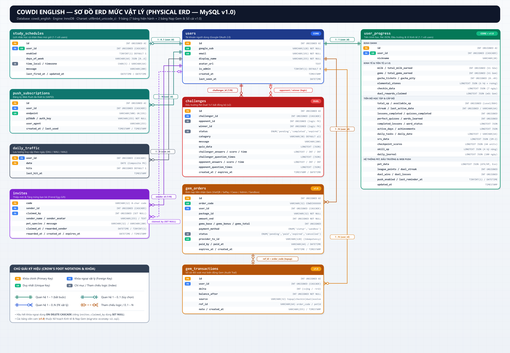
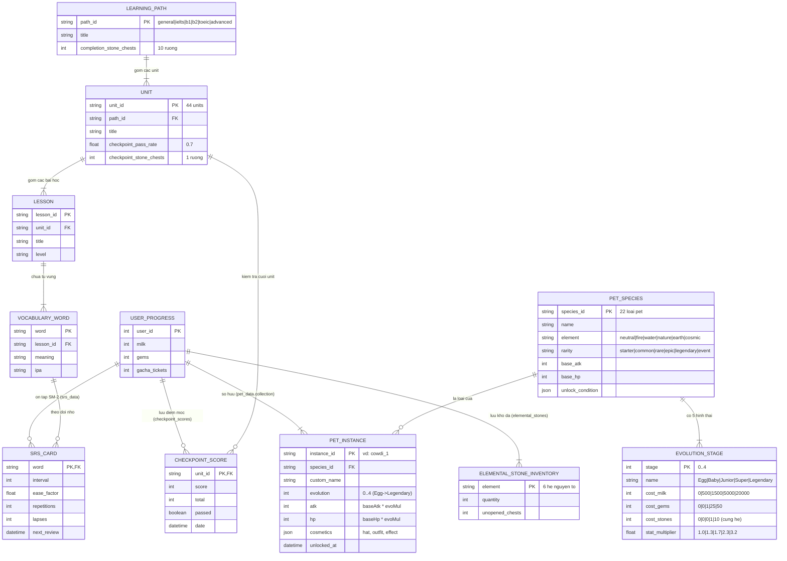
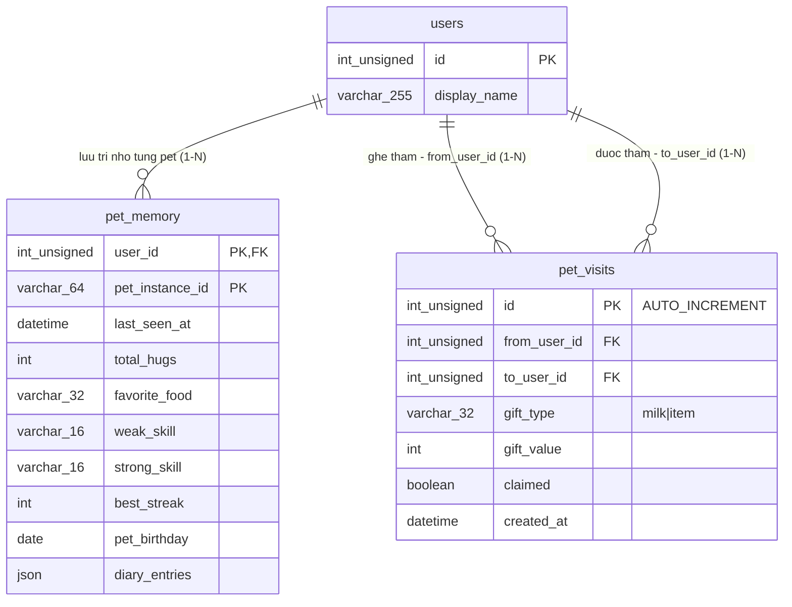

# 🐮 Cowdi English — Tài Liệu Sơ Đồ Thực Thể Quan Hệ (ERD) v1.0

> **Mã tài liệu:** ERD-COWDI-v1.0  
> **Chuẩn tham chiếu:** IEEE 1016-2009 (Software Design Description — Data Design View)  
> **Hệ quản trị CSDL:** MySQL 5.5+ / MariaDB (`InnoDB`, `utf8mb4_unicode_ci`)  
> **Nguồn đối chiếu:** Toàn bộ `server/db/*.sql`, `server/routes/*.js`, `src/data/*`, `docs/01-project-management/SPMP-ECONOMY-PET-v1.0.md`, `docs/04-design/SDD-PET-INTERACTION-v1.0.md`

---

## 1. Tổng quan kiến trúc dữ liệu

Cơ sở dữ liệu `cowdi_english` áp dụng mô hình **Quan hệ kết hợp bán cấu trúc (Relational + JSON Document)** nhằm cân bằng giữa tính toàn vẹn giao dịch (ACID) và tốc độ đồng bộ ngoại tuyến (PWA / `localStorage` ↔ MySQL):

| Nhóm thực thể | Trạng thái | Các bảng / thực thể |
|---|---|---|
| **Cốt lõi hiện hành (Core v1.0)** | Đã triển khai (`server/db/*.sql`) | `users`, `user_progress`, `challenges`, `invites`, `push_subscriptions`, `study_schedules`, `daily_traffic` (7 bảng) |
| **Kinh tế & Nạp Gem (Economy v1.0)** | Theo `SPMP-ECONOMY-PET-v1.0.md` | `gem_orders`, `gem_transactions` + 9 cột mở rộng trên `user_progress` (2 bảng mới) |
| **Dữ liệu JSON lồng (Embedded)** | Lưu trong `user_progress` | `pet_data` (`PET_INSTANCE`), `srs_data`, `checkpoint_scores`, `daily_journal`, `elemental_stones`, `checkin_data` |
| **Danh mục tĩnh (Static Catalog)** | Lưu trên Frontend (`src/data/`) | `LEARNING_PATH` → `UNIT` → `LESSON` → `VOCABULARY`, `PET_SPECIES` (22 loài) → `EVOLUTION_STAGE` (5 cấp), `TOPUP_PACKAGE`, `SHOP_ITEM` |
| **Mở rộng tương lai (Phase 3–4)** | Đề xuất trong `SDD-PET-INTERACTION-v1.0.md` | `pet_memory`, `pet_visits` (2 bảng dự kiến) |

---

## 2. Sơ đồ ERD Vật lý (Physical ERD — MySQL)

> **File ảnh sơ đồ vật lý (chuẩn Crow's Foot):**
> - Ảnh PNG độ phân giải cao (2600×1800px, sẵn sàng chèn Word/Slide/PDF): `docs/04-design/images/cowdi-erd-physical-v1.0.png`
> - Ảnh vector SVG gốc (phóng to vô hạn): `docs/04-design/images/cowdi-erd-physical-v1.0.svg`

Sơ đồ Mermaid tương tác bên dưới thể hiện toàn bộ **9 bảng MySQL** (7 bảng hiện hành + 2 bảng Nạp Gem & Sổ cái theo kế hoạch v1.0) lấy `users` làm thực thể trung tâm:

```mermaid
erDiagram
    users {
        int_unsigned id PK "AUTO_INCREMENT"
        varchar_128 google_sub UK "Google immutable ID"
        varchar_191 email UK
        varchar_255 display_name
        text avatar_url
        tinyint_1 is_admin "0=user, 1=admin"
        timestamp created_at
        datetime last_seen_at
    }

    user_progress {
        int_unsigned id PK "AUTO_INCREMENT"
        int_unsigned user_id FK, UK "1-1 voi users"
        int_unsigned total_xp "Lifetime XP (Level/Ranking)"
        int_unsigned available_xp "Legacy XP wallet"
        int_unsigned milk "Vi Sua (v1.0)"
        int_unsigned total_milk_earned "Tong Sua da kiem (v1.0)"
        int_unsigned gems "Vi Gem sieu hiem (v1.0)"
        int_unsigned total_gems_earned "Tong Gem da nhan (v1.0)"
        int_unsigned gacha_tickets "Ve Gacha (v1.0)"
        int_unsigned gacha_pity "Dem bao hiem 0-49 (v1.0)"
        int_unsigned streak
        varchar_64 last_active_date
        int_unsigned lessons_completed
        int_unsigned quizzes_completed
        int_unsigned perfect_quizzes
        int_unsigned words_learned
        varchar_20 nickname "Ten hien thi BXH"
        int_unsigned league_points
        int_unsigned duel_wins
        int_unsigned duel_losses
        int_unsigned duel_streak
        tinyint_1 push_enabled
        datetime last_reminder_at
        longtext pet_data "JSON: collection, activePetId, items"
        longtext srs_data "JSON: SM-2 per word"
        longtext checkpoint_scores "JSON: score per unit"
        longtext skill_xp "JSON: 4 ky nang nguoi hoc"
        longtext daily_journal "JSON: nhat ky hoc theo ngay"
        longtext elemental_stones "JSON: 6 he da + ruong (v1.0)"
        longtext checkin_data "JSON: diem danh 7 ngay (v1.0)"
        longtext duel_rewards_claimed "JSON: moc thuong Gem Duel (v1.0)"
        timestamp updated_at
    }

    challenges {
        int_unsigned id PK "AUTO_INCREMENT"
        int_unsigned challenger_id FK "Nguoi tao thach dau"
        int_unsigned opponent_id "Nguoi chap nhan (logic FK)"
        int_unsigned winner_id "Nguoi thang (logic FK)"
        enum status "pending|completed|expired"
        varchar_30 category "all|vocabulary|grammar|sentences|listening"
        varchar_280 message
        longtext quiz_data "JSON danh sach cau hoi"
        longtext challenger_answers "JSON dap an"
        int_unsigned challenger_score
        int_unsigned challenger_time
        longtext challenger_question_times "JSON thoi gian tung cau"
        longtext opponent_answers "JSON dap an"
        int_unsigned opponent_score
        int_unsigned opponent_time
        longtext opponent_question_times "JSON thoi gian tung cau"
        timestamp created_at
        datetime expires_at
    }

    invites {
        varchar_12 code PK "Ma thiep 8 ky tu"
        int_unsigned sender_id FK "Nguoi gui trung"
        int_unsigned claimed_by FK "Nguoi nhan (SET NULL)"
        varchar_255 sender_name
        text sender_avatar
        varchar_32 pet_species
        varchar_280 message
        datetime claimed_at
        tinyint_1 rewarded_sender
        datetime rewarded_at
        timestamp created_at
        datetime expires_at
    }

    push_subscriptions {
        int_unsigned id PK "AUTO_INCREMENT"
        int_unsigned user_id FK
        varchar_500 endpoint UK "Unique prefix 191"
        varchar_255 p256dh
        varchar_255 auth_key
        varchar_255 user_agent
        timestamp created_at
        timestamp last_used
    }

    study_schedules {
        int_unsigned id PK "AUTO_INCREMENT"
        int_unsigned user_id FK, UK "1-1 voi users"
        tinyint_1 enabled
        varchar_64 days_of_week "JSON [0..6]"
        char_5 time_local "HH:MM"
        varchar_64 timezone "IANA TZ"
        varchar_200 message
        datetime last_fired_at
        timestamp created_at
        datetime updated_at
    }

    daily_traffic {
        int_unsigned user_id PK, FK
        date date PK "Composite PK"
        int_unsigned hits
        timestamp last_hit_at
    }

    gem_orders {
        int_unsigned id PK "AUTO_INCREMENT"
        varchar_32 order_code UK "COWDIXXXXXX"
        int_unsigned user_id FK
        varchar_32 package_id "starter|super_pack|legend_pack..."
        int_unsigned amount_vnd
        int_unsigned gems_base
        int_unsigned gems_bonus
        int_unsigned gems_total
        enum payment_method "vietqr|sandbox"
        enum status "pending|paid|expired|cancelled"
        varchar_128 provider_tx_id UK "Idempotency webhook"
        varchar_64 paid_by "webhook_sepay|casso|admin|sandbox"
        datetime paid_at
        datetime expires_at
        timestamp created_at
    }

    gem_transactions {
        int_unsigned id PK "AUTO_INCREMENT"
        int_unsigned user_id FK
        int delta "+cong / -tru"
        int_unsigned balance_after
        varchar_32 source "topup|checkin_day7|duel|evolve|exchange"
        varchar_64 ref_id "order_code / petId / duelId"
        varchar_255 note
        timestamp created_at
    }

    users ||--|| user_progress : "so huu (1-1)"
    users ||--o| study_schedules : "cai dat lich hoc (1-0..1)"
    users ||--o{ push_subscriptions : "dang ky thiet bi (1-N)"
    users ||--o{ daily_traffic : "ghi nhan truy cap ngay (1-N)"
    users ||--o{ challenges : "tao thach dau - challenger_id (1-N)"
    users |o--o{ challenges : "tham gia - opponent_id (0..1-N)"
    users |o--o{ challenges : "thang tran - winner_id (0..1-N)"
    users ||--o{ invites : "gui thiep trung - sender_id (1-N)"
    users |o--o{ invites : "nhan thiep - claimed_by (0..1-N)"
    users ||--o{ gem_orders : "tao don nap Gem (1-N)"
    users ||--o{ gem_transactions : "ghi so cai Gem (1-N)"
    gem_orders |o--o| gem_transactions : "phat sinh giao dich ref_id"
```

---

## 3. Sơ đồ ERD Mức Khái Niệm (Dữ liệu JSON & Kho Nội Dung Học)

Bên trong cột `LONGTEXT/JSON` của `user_progress` và thư mục `src/data/` tồn tại các thực thể nghiệp vụ quan trọng sau:

---

## 4. Sơ đồ ERD Mở Rộng Tương Lai (Phase 3–4 — Tương Tác Pet)

Theo tài liệu `docs/04-design/SDD-PET-INTERACTION-v1.0.md` (chưa migrate, dự kiến triển khai ở giai đoạn tiếp theo):

---

## 5. Từ điển dữ liệu chi tiết (Data Dictionary)

### 5.1. Bảng `users`
Lưu thông tin định danh tài khoản đăng nhập qua Google OAuth 2.0.

| Cột | Kiểu dữ liệu | Ràng buộc | Mô tả |
|---|---|---|---|
| `id` | `INT UNSIGNED` | `PK, AUTO_INCREMENT` | Mã định danh người dùng |
| `google_sub` | `VARCHAR(128)` | `NOT NULL, UNIQUE` | Subject ID bất biến từ Google OAuth |
| `email` | `VARCHAR(191)` | `NOT NULL, UNIQUE` | Địa chỉ email tài khoản |
| `display_name` | `VARCHAR(255)` | `NOT NULL, DEFAULT ''` | Tên hiển thị mặc định từ Google |
| `avatar_url` | `TEXT` | `NULL` | Ảnh đại diện Google |
| `is_admin` | `TINYINT(1)` | `NOT NULL, DEFAULT 0` | Cờ phân quyền quản trị (`1 = Admin`) |
| `created_at` | `TIMESTAMP` | `DEFAULT CURRENT_TIMESTAMP` | Thời điểm tạo tài khoản |
| `last_seen_at` | `DATETIME` | `NULL` | Lần hoạt động gần nhất |

### 5.2. Bảng `user_progress`
Lưu toàn bộ tiến trình học, chỉ số đấu trường, cài đặt nhắc học, dữ liệu Pet và ví kinh tế (quan hệ **1–1** với `users`).

| Nhóm | Cột | Kiểu dữ liệu | Ràng buộc / Ghi chú |
|---|---|---|---|
| **Định danh** | `id`, `user_id` | `INT UNSIGNED` | `id` PK; `user_id` UNIQUE FK → `users(id) ON DELETE CASCADE` |
| **Tiến trình học** | `total_xp`, `available_xp`, `streak`, `lessons_completed`, `quizzes_completed`, `perfect_quizzes`, `words_learned` | `INT UNSIGNED` | `total_xp` chỉ tăng (Level & BXH); `available_xp` là ví XP cũ (migrate sang `milk`) |
| **Kinh tế v1.0** | `milk`, `total_milk_earned`, `gems`, `total_gems_earned`, `gacha_tickets`, `gacha_pity` | `INT UNSIGNED` | Ví Sữa, Gem, Vé Gacha, bộ đếm Pity (theo `SPMP-ECONOMY-PET-v1.0.md`) |
| **Đấu trường** | `nickname`, `league_points`, `duel_wins`, `duel_losses`, `duel_streak` | `VARCHAR(20)` / `INT UNSIGNED` | Thống kê PvP & BXH ẩn danh |
| **Thông báo** | `push_enabled`, `last_reminder_at` | `TINYINT(1)` / `DATETIME` | Cờ nhận Web Push & chống spam nhắc streak |
| **JSON hiện hành** | `completed_lessons`, `word_status`, `active_days`, `achievements`, `daily_tasks`, `srs_data`, `checkpoint_scores`, `skill_xp`, `daily_journal`, `pet_data` | `LONGTEXT` | Dữ liệu học tập, SRS SM-2, nhật ký ngày và bộ sưu tập Pet |
| **JSON kinh tế v1.0** | `elemental_stones`, `checkin_data`, `duel_rewards_claimed` | `LONGTEXT` | Kho 6 hệ đá + rương, lịch sử điểm danh 7 ngày, mốc nhận Gem Duel |
| **Thời gian** | `last_active_date`, `daily_date`, `updated_at` | `VARCHAR(64)` / `TIMESTAMP` | Mốc ngày hoạt động và thời điểm cập nhật cuối |

### 5.3. Bảng `challenges` (Đấu trường Pet Duel 1v1)
| Cột | Kiểu dữ liệu | Ràng buộc | Mô tả |
|---|---|---|---|
| `id` | `INT UNSIGNED` | `PK, AUTO_INCREMENT` | Mã trận thách đấu |
| `challenger_id` | `INT UNSIGNED` | `NOT NULL, FK → users(id) CASCADE` | Người tạo thách đấu |
| `opponent_id` | `INT UNSIGNED` | `NULL, INDEX` | Người nhận thách đấu (tham chiếu logic `users.id`) |
| `winner_id` | `INT UNSIGNED` | `NULL` | Người chiến thắng (`NULL` nếu hòa hoặc chưa đấu) |
| `status` | `ENUM` | `'pending','completed','expired'` | Trạng thái trận đấu |
| `category` | `VARCHAR(30)` | `DEFAULT 'all'` | Chủ đề: `all`, `vocabulary`, `grammar`, `sentences`, `listening` |
| `message` | `VARCHAR(280)` | `NULL` | Lời nhắn thách đấu |
| `quiz_data` | `LONGTEXT` | `NOT NULL` | JSON mảng câu hỏi (10–30 câu) |
| `challenger_*`, `opponent_*` | `LONGTEXT` / `INT UNSIGNED` | — | Đáp án, điểm số, tổng thời gian và thời gian từng câu (Duel v2) |
| `created_at`, `expires_at` | `TIMESTAMP` / `DATETIME` | — | Hiệu lực mặc định 24 giờ |

### 5.4. Bảng `invites` (Thiệp mời / Tặng trứng bạn bè)
| Cột | Kiểu dữ liệu | Ràng buộc | Mô tả |
|---|---|---|---|
| `code` | `VARCHAR(12)` | `PK` | Mã thiệp 8 ký tự ngẫu nhiên (`A-Z, 2-9`) |
| `sender_id` | `INT UNSIGNED` | `NOT NULL, FK → users(id) CASCADE` | Người gửi thiệp |
| `claimed_by` | `INT UNSIGNED` | `NULL, FK → users(id) SET NULL` | Người đã nhận thiệp |
| `sender_name`, `sender_avatar` | `VARCHAR(255)` / `TEXT` | — | Snapshot tên/ảnh người gửi để hiển thị trang công khai `/i/:code` |
| `pet_species`, `message` | `VARCHAR(32)` / `VARCHAR(280)` | — | Loài trứng tặng & lời nhắn |
| `claimed_at`, `rewarded_sender`, `rewarded_at` | `DATETIME` / `TINYINT(1)` | — | Trạng thái nhận & trả thưởng cho người gửi |
| `created_at`, `expires_at` | `TIMESTAMP` / `DATETIME` | — | Hiệu lực 7 ngày |

### 5.5. Bảng `push_subscriptions`
| Cột | Kiểu dữ liệu | Ràng buộc | Mô tả |
|---|---|---|---|
| `id` | `INT UNSIGNED` | `PK, AUTO_INCREMENT` | Mã đăng ký |
| `user_id` | `INT UNSIGNED` | `NOT NULL, FK → users(id) CASCADE` | Chủ sở hữu thiết bị (1 user có nhiều thiết bị) |
| `endpoint` | `VARCHAR(500)` | `NOT NULL, UNIQUE(191)` | Push endpoint URL từ trình duyệt |
| `p256dh`, `auth_key` | `VARCHAR(255)` | `NOT NULL` | Khóa mã hóa Web Push (VAPID) |
| `user_agent`, `created_at`, `last_used` | `VARCHAR(255)` / `TIMESTAMP` | — | Thông tin thiết bị & lần gửi gần nhất |

### 5.6. Bảng `study_schedules`
| Cột | Kiểu dữ liệu | Ràng buộc | Mô tả |
|---|---|---|---|
| `id` | `INT UNSIGNED` | `PK, AUTO_INCREMENT` | Mã lịch học |
| `user_id` | `INT UNSIGNED` | `NOT NULL, UNIQUE, FK → users(id) CASCADE` | Quan hệ 1–1 với `users` |
| `enabled` | `TINYINT(1)` | `DEFAULT 1` | Bật/tắt nhắc lịch |
| `days_of_week` | `VARCHAR(64)` | `DEFAULT '[1,2,3,4,5]'` | JSON mảng thứ trong tuần (`0=CN..6=T7`) |
| `time_local`, `timezone` | `CHAR(5)` / `VARCHAR(64)` | `DEFAULT '19:00'`, `'Asia/Ho_Chi_Minh'` | Giờ nhắc cục bộ & múi giờ IANA |
| `message`, `last_fired_at`, `created_at`, `updated_at` | `VARCHAR(200)` / `DATETIME` | — | Lời nhắc tùy chỉnh & chống gửi lặp trong ngày |

### 5.7. Bảng `daily_traffic`
| Cột | Kiểu dữ liệu | Ràng buộc | Mô tả |
|---|---|---|---|
| `user_id` | `INT UNSIGNED` | `PK, FK → users(id) CASCADE` | Người dùng truy cập |
| `date` | `DATE` | `PK, INDEX` | Ngày truy cập (khóa chính tổ hợp `(user_id, date)`) |
| `hits` | `INT UNSIGNED` | `DEFAULT 1` | Số lượt gọi API trong ngày |
| `last_hit_at` | `TIMESTAMP` | `ON UPDATE CURRENT_TIMESTAMP` | Thời điểm gọi gần nhất |

### 5.8. Bảng `gem_orders` *(Kế hoạch Kinh tế v1.0)*
| Cột | Kiểu dữ liệu | Ràng buộc | Mô tả |
|---|---|---|---|
| `id` | `INT UNSIGNED` | `PK, AUTO_INCREMENT` | Mã đơn nội bộ |
| `order_code` | `VARCHAR(32)` | `NOT NULL, UNIQUE` | Mã chuyển khoản VietQR (`COWDIXXXXXX`) |
| `user_id` | `INT UNSIGNED` | `NOT NULL, FK → users(id) CASCADE` | Người mua gói Gem |
| `package_id` | `VARCHAR(32)` | `NOT NULL` | Mã gói (`starter`, `super_pack`, `legend_pack`, `master_pack`, `vip_pack`) |
| `amount_vnd` | `INT UNSIGNED` | `NOT NULL` | Số tiền cần chuyển (VNĐ) |
| `gems_base`, `gems_bonus`, `gems_total` | `INT UNSIGNED` | `NOT NULL` | Chi tiết Gem gốc, bonus và tổng thực nhận |
| `payment_method` | `ENUM` | `'vietqr','sandbox'` | Kênh thanh toán |
| `status` | `ENUM` | `'pending','paid','expired','cancelled'` | Trạng thái đơn hàng |
| `provider_tx_id` | `VARCHAR(128)` | `NULL, UNIQUE` | Mã giao dịch ngân hàng từ SePay/Casso (chống cộng trùng) |
| `paid_by`, `paid_at`, `expires_at`, `created_at` | `VARCHAR(64)` / `DATETIME` | — | Kênh xác nhận (`webhook_sepay`, `webhook_casso`, `admin:<id>`, `sandbox`) và hạn 15 phút |

### 5.9. Bảng `gem_transactions` *(Kế hoạch Kinh tế v1.0)*
| Cột | Kiểu dữ liệu | Ràng buộc | Mô tả |
|---|---|---|---|
| `id` | `INT UNSIGNED` | `PK, AUTO_INCREMENT` | Mã bút toán sổ cái |
| `user_id` | `INT UNSIGNED` | `NOT NULL, FK → users(id) CASCADE` | Tài khoản biến động Gem |
| `delta` | `INT` | `NOT NULL` | Số lượng thay đổi (`> 0` cộng, `< 0` trừ) |
| `balance_after` | `INT UNSIGNED` | `NOT NULL` | Số dư Gem sau giao dịch |
| `source` | `VARCHAR(32)` | `NOT NULL` | Nguồn: `topup`, `checkin_day7`, `duel_streak`, `duel_league`, `evolve_pet`, `exchange_milk`, `admin_grant` |
| `ref_id` | `VARCHAR(64)` | `NULL` | Mã tham chiếu (`order_code`, `petInstanceId`, `duelId`) |
| `note`, `created_at` | `VARCHAR(255)` / `TIMESTAMP` | — | Ghi chú đối soát và thời điểm ghi nhận |

---

## 6. Bảng tổng hợp Quan hệ & Lưu ý toàn vẹn dữ liệu

| Thực thể cha | Thực thể con | Bản số | Cột khóa ngoại | Hành vi xóa (`ON DELETE`) |
|---|---|---|---|---|
| `users` | `user_progress` | `1 : 1` | `user_progress.user_id` (`UNIQUE`) | `CASCADE` |
| `users` | `study_schedules` | `1 : 0..1` | `study_schedules.user_id` (`UNIQUE`) | `CASCADE` |
| `users` | `push_subscriptions` | `1 : N` | `push_subscriptions.user_id` | `CASCADE` |
| `users` | `daily_traffic` | `1 : N` | `daily_traffic.user_id` | `CASCADE` |
| `users` | `challenges` | `1 : N` | `challenges.challenger_id` | `CASCADE` |
| `users` | `invites` (người gửi) | `1 : N` | `invites.sender_id` | `CASCADE` |
| `users` | `invites` (người nhận) | `0..1 : N` | `invites.claimed_by` | `SET NULL` |
| `users` | `gem_orders` | `1 : N` | `gem_orders.user_id` | `CASCADE` |
| `users` | `gem_transactions` | `1 : N` | `gem_transactions.user_id` | `CASCADE` |

> **Lưu ý kỹ thuật phát hiện qua rà soát mã nguồn:**
> 1. Trong `server/db/migrate-social.sql`, hai cột `challenges.opponent_id` và `challenges.winner_id` hiện mới có `INDEX`, **chưa khai báo ràng buộc `FOREIGN KEY` vật lý** tới `users(id)` (chỉ mới có FK cho `challenger_id`). Khi chuẩn hóa CSDL có thể bổ sung `ON DELETE SET NULL` để giữ lịch sử trận đấu nếu tài khoản đối thủ bị xóa.
> 2. Mọi thay đổi số dư **Gem** trong `gem_orders` → `user_progress.gems` → `gem_transactions` bắt buộc chạy trong **MySQL Transaction** với `SELECT ... FOR UPDATE` và kiểm tra tính bất biến (`provider_tx_id UNIQUE`) để chống race-condition hoặc webhook gửi trùng.
> 3. Toàn bộ danh mục bài học (`LESSONS`, `UNITS`, `EXAM_PATHS`) và danh mục Pet (`PET_REGISTRY`) hiện được quản lý dạng **static bundle trên Frontend** để tối ưu tốc độ tải và hỗ trợ học ngoại tuyến (PWA), nên không cần tách thành bảng MySQL trừ khi có nhu cầu CMS chỉnh sửa bài học trực tiếp từ Admin.
