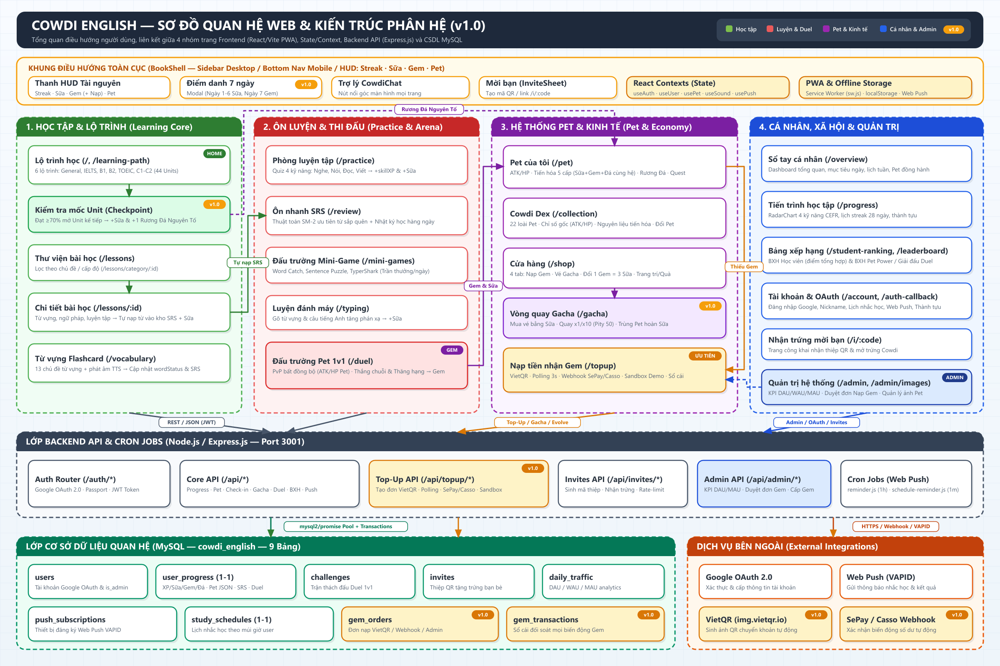
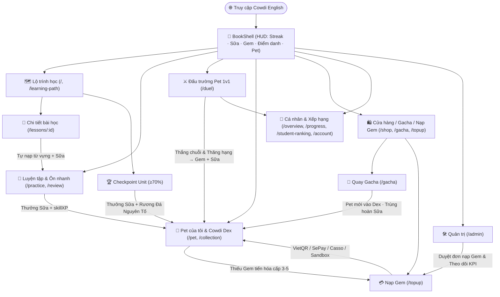

# 🐮 Cowdi English — Tài Liệu Sơ Đồ Quan Hệ Web & Kiến Trúc Phân Hệ v1.0

> **Mã tài liệu:** WRD-COWDI-v1.0  
> **Chuẩn tham chiếu:** IEEE 1016-2009 (Software Design Description — Interface, Navigation & Component View)  
> **Phạm vi:** Toàn bộ các trang (Routes), Khung điều hướng (`BookShell`), Context/State, Backend API (Express.js), CSDL MySQL và Tích hợp ngoài (bao gồm Kinh tế v1.0: Nạp Gem, Sữa, Đá nguyên tố, Gacha, Điểm danh)  
> **Tài liệu liên quan:** [ERD-COWDI-v1.0.md](ERD-COWDI-v1.0.md) · [SPMP-ECONOMY-PET-v1.0.md](../01-project-management/SPMP-ECONOMY-PET-v1.0.md)

---

## 1. Hình ảnh Sơ đồ Quan hệ Web tổng thể

> **File ảnh gốc:**
> - Ảnh PNG độ phân giải cao (2400×1600px, sẵn sàng chèn Word/Slide/PDF): `docs/04-design/images/cowdi-web-relationship-v1.0.png`
> - Ảnh vector SVG (phóng to vô hạn không vỡ nét): `docs/04-design/images/cowdi-web-relationship-v1.0.svg`

---

## 2. Sơ đồ Luồng Điều Hướng & Tương Tác Người Dùng (User Journey)

---

## 3. Ma trận Quan hệ Các Trang & Phân Hệ (Route Relationship Matrix)

### 3.1. Nhóm 1 — Học tập & Lộ trình (`Learning Core`)
| Route | Component | Chức năng chính | Liên kết sang trang khác | API / State sử dụng |
|---|---|---|---|---|
| `/`, `/learning-path` | `LearningPathPage` | 6 lộ trình tuyến tính (General, IELTS, B1, B2, TOEIC, C1–C2; 44 Units) + bài Checkpoint | → `/lessons/:id`, → Mở Rương Đá (`/pet`) | `useUser`, `usePet`, `/api/progress`, `/api/stones/claim` |
| `/lessons`, `/lessons/category/:id` | `LessonsPage` | Thư viện toàn bộ bài học lọc theo chủ đề & cấp độ | → `/lessons/:id` | `useUser` |
| `/lessons/:id` | `LessonDetailPage` | Học từ vựng, ngữ pháp, bài tập; tự động nạp từ vào kho SRS | → `/review`, → `/learning-path` | `useUser`, `usePet` |
| `/vocabulary` | `VocabularyPage` | Flashcard 13 chủ đề + phát âm TTS; cập nhật trạng thái thuộc từ | → `/review` | `useUser`, `speech.js` |

### 3.2. Nhóm 2 — Ôn luyện & Thi đấu (`Practice & Arena`)
| Route | Component | Chức năng chính | Liên kết sang trang khác | API / State sử dụng |
|---|---|---|---|---|
| `/practice` | `PracticePage` | Quiz đa dạng 4 kỹ năng (Nghe, Nói, Đọc, Viết) | → `/pet`, → `/progress` | `useUser`, `usePet`, `useSound` |
| `/review` | `ReviewPage` | Ôn tập thông minh thuật toán SM-2 + Nhật ký học (`StudyJournalCard`) | → `/vocabulary`, → `/lessons` | `useUser`, `usePet` |
| `/mini-games` | `MiniGamePage` | Mini-game từ vựng & câu (Word Catch, Sentence Puzzle, TyperShark) có trần thưởng/ngày | → `/typing`, → `/pet` | `useUser`, `usePet` |
| `/typing` | `TypingPage` | Luyện gõ từ vựng & câu tiếng Anh tăng tốc độ phản xạ | → `/mini-games` | `useUser`, `usePet` |
| `/duel` | `DuelPage` | Đấu trường Pet 1v1 bất đồng bộ (hiển thị ATK/HP Pet); thắng chuỗi & thăng hạng nhận **Gem** | → `/leaderboard`, → `/pet` | `useAuth`, `usePet`, `/api/duel*`, `/api/my-stats` |

### 3.3. Nhóm 3 — Hệ thống Pet & Kinh tế (`Pet & Economy v1.0`)
| Route | Component | Chức năng chính | Liên kết sang trang khác | API / State sử dụng |
|---|---|---|---|---|
| `/pet` | `PetPage` | Xem Pet đồng hành, Chỉ số chiến đấu (ATK/HP), Tiến hóa 5 cấp (Sữa + Gem + Đá cùng hệ), Nhiệm vụ ngày | → `/collection`, → `/shop`, → `/gacha`, → `/topup` | `usePet`, `/api/pet/evolve`, `/api/stones/open-chest` |
| `/collection` | `CollectionPage` | **Cowdi Dex** 22 loài Pet: Chỉ số gốc (ATK/HP), Nguyên liệu tiến hóa, chọn Pet đồng hành | → `/pet`, → `/gacha`, → `/topup` | `usePet`, `useUser` |
| `/shop` | `ShopPage` | Cửa hàng 4 tab: Nạp Gem, Vé Gacha, Đổi `1 Gem = 3 Sữa`, Trang trí & Quà tặng | → `/gacha`, → `/topup`, → `InviteSheet` | `usePet`, `/api/economy/exchange`, `/api/gacha/buy-ticket` |
| `/gacha` *(v1.0)* | `GachaPage` | Mua vé bằng Sữa, quay `x1` / `x10` (Pity 50, x10 ≥ Rare), trùng Pet hoàn Sữa | → `/collection`, → `/shop` | `usePet`, `/api/gacha/pull` |
| `/topup` *(v1.0)* | `TopUpPage` | **Nạp tiền nhận Gem (Ưu tiên #1)**: 5 gói nạp, mã VietQR, polling 3s, Sandbox Demo, Sổ cái Gem | → `/pet`, → `/shop` | `useAuth`, `usePet`, `/api/topup/*` |

### 3.4. Nhóm 4 — Cá nhân, Xã hội & Quản trị (`Profile, Social & Admin`)
| Route | Component | Chức năng chính | Liên kết sang trang khác | API / State sử dụng |
|---|---|---|---|---|
| `/overview` | `HomePage` | Sổ tay cá nhân: chào hỏi, mục tiêu ngày, lịch học tuần, Pet đồng hành | → `/learning-path`, `/pet`, `/duel`, `/progress` | `useUser`, `usePet`, `useAuth` |
| `/progress` | `ProgressPage` | Biểu đồ Radar 4 kỹ năng CEFR, cấp độ, lịch streak 28 ngày, thành tựu | → `/learning-path`, → `/account` | `useUser`, `usePet` |
| `/student-ranking`, `/leaderboard` | `StudentRankingPage`, `LeaderboardPage` | BXH Học viên (điểm tổng hợp) & BXH Pet Power / Giải đấu Duel | → `/duel`, → `/account` | `/api/student-rankings`, `/api/leaderboard`, `/api/rankings` |
| `/account`, `/auth-callback` | `AccountPage`, `AuthCallbackPage` | Google OAuth, đổi Nickname, cài đặt Lịch nhắc học & Web Push, Thành tựu | → `/progress`, → `/topup` | `useAuth`, `usePush`, `useSchedule`, `/auth/*`, `/api/schedule`, `/api/push/*` |
| `/i/:code` | `InvitePage` | Trang công khai nhận thiệp mời QR & trứng Pet từ bạn bè | → `/`, → `/pet` | `/api/invites/:code`, `/api/invites/:code/claim` |
| `/admin`, `/admin/images` | `AdminPage`, `AdminImageManagerPage` | Dashboard KPI (DAU/WAU/MAU, Retention), **Quản trị & Duyệt đơn Nạp Gem**, Quản lý ảnh Pet | — | `/api/admin/*` (yêu cầu `is_admin = 1`) |

---

## 4. Quan hệ giữa Khung Toàn Cục, State & Hạ Tầng Đồng Bộ

1. **Khung giao diện (`BookShell.jsx`)**: Bao bọc toàn bộ route, cung cấp thanh điều hướng Desktop (dạng sổ tay chia 4 chương), thanh Bottom Nav Mobile và thanh **HUD tài nguyên** (`Streak · Sữa · Gem (+ Nạp) · Điểm danh · Pet`) giúp người dùng chuyển tức thời sang `/topup`, `/pet`, hoặc mở `DailyCheckInModal` từ bất kỳ trang nào.
2. **Mô hình Đồng bộ 2 lớp (Offline-first PWA)**:
   - Khách chưa đăng nhập lưu trực tiếp trên `localStorage` qua `useUser` và `usePet`.
   - Người dùng đã đăng nhập Google OAuth đồng bộ tự động (debounce 3 giây + `keepalive` khi ẩn tab) với Express API và MySQL, áp dụng thuật toán hợp nhất tăng đơn điệu (`monotonic merge`) để không mất tiến độ khi dùng nhiều thiết bị.
   - Riêng các tác vụ nhạy cảm về tiền tệ (**Nạp Gem, Điểm danh ngày 7, Thưởng Gem Duel, Quay Gacha, Tiến hóa Pet**) đều được **xác thực và ghi nhận phía Server** thông qua MySQL Transaction để chống gian lận từ phía client.
3. **Tác vụ nền (Cron Jobs) & Dịch vụ ngoài**:
   - `server/jobs/reminder.js` (chạy mỗi 1 giờ) và `server/jobs/schedule-reminder.js` (chạy mỗi 1 phút) truy vấn `user_progress`, `study_schedules`, `push_subscriptions` để gửi **Web Push (VAPID)** nhắc giữ streak và đúng giờ học.
   - `server/routes/topup.js` kết nối **VietQR (`img.vietqr.io`)** để sinh mã chuyển khoản và tiếp nhận **Webhook SePay / Casso** tự động cộng Gem và gửi thông báo đẩy cho người dùng.
