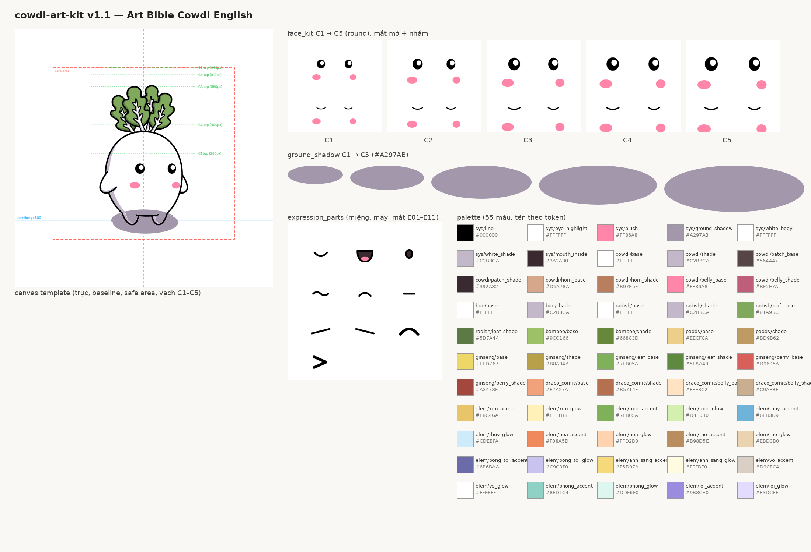

# STD-ART-STYLE v1.1 — Quy chuẩn Mỹ thuật & Nhận diện Hình ảnh Toàn dự án (Art Bible & Visual Style Standard)

| Mục | Giá trị |
|---|---|
| **Mã tài liệu** | `STD-ART-STYLE` |
| **Phiên bản** | `1.1` · **Ngày ban hành:** `2026-11-24` |
| **Trạng thái** | `Approved` (Nguyên tắc bắt buộc toàn dự án) |
| **Chuẩn tham chiếu** | ISO/IEC/IEEE 12207 · Quy ước tài liệu: [DOCP-COWDI-v1.1](../../00-general/DOCP-COWDI-v1.1.md) |
| **Phạm vi áp dụng** | Toàn bộ tài sản mỹ thuật Cowdi English: Pet (5 cấp C1–C5), Biểu cảm (E00–E11), Bộ phận `PetRig`, Comic, Minh họa bài học, Đồ trang trí, Icon & CSS Token |
| **Nguồn máy đọc (Single Source of Truth)** | [art-spec.json](art-spec.json) · [palettes/cowdi_tokens.css](palettes/cowdi_tokens.css) · [prompts/AI_PROMPT_BLOCKS.md](prompts/AI_PROMPT_BLOCKS.md) |
| **Tài liệu liên quan** | [art/README.md](README.md) · [PET-MOTION.md](../../PET-MOTION.md) · [GDE-PET-IMAGES-v1.0.md](../GDE-PET-IMAGES-v1.0.md) · [REG-UI-ICONS.md](../REG-UI-ICONS.md) · [REG-IMAGE-CATALOG.md](../REG-IMAGE-CATALOG.md) |

## Lịch sử sửa đổi

| Phiên bản | Ngày | Nội dung | Người sửa |
|---|---|---|---|
| 1.0 | 2026-11-24 | Bản đầu Art Bible & Visual Style Standard (chuẩn hoá từ 6 sprite gốc 1080 px) | Product Owner (Sonny) |
| 1.1 | 2026-11-24 | Đóng gói `cowdi-art-kit v1.1` (55 token màu, SVG template 2160/1080, Face Kit C1–C5, Ground Shadow C1–C5, Prompt Blocks, `qc_check.py`, `palette_lock.py`) và hợp nhất thành quy chuẩn bắt buộc toàn dự án trong `docs/05-implementation/art/` | Sonny + AI |

> [!IMPORTANT]
> **Nguyên tắc ưu tiên toàn dự án:** Khi có bất kỳ khác biệt nào về phong cách vẽ, độ dày nét, đổ bóng, bộ mặt, bóng đất, bảng màu 10 hệ nguyên tố hay quy trình tạo ảnh AI giữa tài liệu này với các tài liệu ảnh cũ (`GDE-PET-IMAGES-v1.0.md`, `REG-IMAGE-CATALOG.md`, `REG-UI-ICONS.md`), **`STD-ART-STYLE-v1.1.md` và `art-spec.json` là nguồn sự thật cao nhất**. Mọi sửa đổi hằng số phải cập nhật đồng bộ giữa tài liệu này và [art-spec.json](art-spec.json) trong cùng một commit.

---

## 1. Tầm nhìn, Đối tượng & 7 Quyết định đã chốt (`Q1–Q7`)

Phong cách mỹ thuật Cowdi English hướng tới cảm giác **"dễ thương trước, sạch như sticker, hiền hòa và nhất quán"** dành cho học sinh nhỏ tuổi (**4–12 tuổi**).

### 1.1. Các quyết định nền tảng đã chốt (`art-spec.json#decisions`)

| Mã | Quyết định đã chốt | Ý nghĩa áp dụng |
|---|---|---|
| **Q1** | **Flat vector** là chuẩn chính thức cho toàn bộ Pet | Không dùng 3D, không tả thực, không painterly/airbrush/gradient trên sprite pet |
| **Q2** | **Tên trong comic = tên hiển thị**; `sprout` đổi thành **giá đỗ** | Đồng nhất tên gọi giữa app, truyện tranh và mô tả nhân vật |
| **Q3** | **Nhân sâm (`ginseng`) giữ lông mày ở trạng thái idle** | Ngoại lệ duy nhất được phép có lông mày ngắn điềm tĩnh ở `E00` |
| **Q4** | **Trứng cấp C1 có mắt** | Mọi trứng/mầm C1 đều gắn mắt từ `face_kit_c1_*` để giữ tính thân thiện với trẻ 4–12 tuổi |
| **Q5** | **Chốt bảng màu 10 hệ nguyên tố & Nhân sâm** | Dùng đúng 55 token màu trong `palettes/`, thay thế bảng màu nguyên tố cũ |
| **Q6** | **Đối tượng mục tiêu: 4–12 tuổi** | Hình khối tròn trịa, biểu cảm hiền, cấm yếu tố đáng sợ (răng nanh, mắt đỏ, mặt giận dữ) |
| **Q7** | **Draco bản comic đổi màu sang hệ Hỏa** | Dùng bảng màu `draco_comic` (`#F2A27A` / `#B5714F`, bụng `#FFE3C2` / `#C9AE8F`) |

### 1.2. Phân tầng tài sản & ngưỡng QC

| Tầng | Phạm vi tài sản | Ngưỡng QC đạt | Ghi chú |
|---|---|---|---|
| **Tầng A (Tier A)** | Sprite Pet trong app (`C1–C5`), bộ phận `PetRig`, biểu cảm `E00–E11`, đồ trang trí gắn lên pet | **≥ 90 điểm** + PASS `qc_check.py` | Bắt buộc tuân thủ 100% canvas, baseline, nét, bảng màu, Face Kit |
| **Tầng B (Tier B)** | Khung truyện tranh (Comic), minh họa tình huống bài học (Starter `sceneBrief`), ảnh ghép nhiều nhân vật | **≥ 80 điểm** | Nhân vật tuân thủ `COWDI STYLE` (cho phép miệng/mày biểu cảm); nền phẳng bão hòa thấp, nét mảnh hơn hoặc không nét để nổi nhân vật |
| **Tầng C (Tier C)** | Banner, ảnh marketing, phụ trợ truyền thông | **≥ 80 điểm** | Giữ đúng bảng màu hệ thống, tỉ lệ tương đối giữa các nhân vật và nhận diện khuôn mặt |

---

## 2. Quy chuẩn Canvas, Trục tâm, Baseline & Vùng an toàn

Mọi số đo trong [art-spec.json](art-spec.json) lấy chuẩn theo khung xuất **1080 × 1080 px**; họa sĩ vẽ trên file **master 2160 × 2160 px (×2)** để bảo toàn độ sắc nét.

| Thông số | Chuẩn xuất (`1080 px`) | File Master (`2160 px`) | Quy tắc bắt buộc |
|---|---|---|---|
| **Kích thước canvas** | `1080 × 1080 px` | `2160 × 2160 px` | Tỉ lệ `1:1` vuông |
| **Trục tâm dọc (`center_x`)** | `x = 540` | `x = 1080` | Sai số cho phép khi QC: `±10 px` (@1080) |
| **Đường chân (`baseline_y`)** | `y = 800` | `y = 1600` | Tâm bóng đất đặt tại `(540, 800)`; đáy bóng đất `y = 800 + h/2` (`±15 px` @1080) |
| **Vùng an toàn (`safe_area`)** | `x: 160–920`, `y: 160–880` (`760 × 720 px`) | `x: 320–1840`, `y: 320–1760` | Toàn bộ nhân vật, vương miện, tay chân và bóng đất **không được vượt ra ngoài** |
| **Nền (`background`)** | Trong suốt (`transparent`) hoặc `#FFFFFF` | Trong suốt | File xuất vào ứng dụng bắt buộc **nền trong suốt**; khi sinh ảnh AI dùng nền trắng tinh `#FFFFFF` rồi tách sạch |

- **Khung vẽ có sẵn:** Mở trực tiếp [templates/canvas_2160_template.svg](templates/canvas_2160_template.svg) (master) hoặc [templates/canvas_1080_template.svg](templates/canvas_1080_template.svg) (kiểm tra/xuất). **Bắt buộc ẩn layer `GUIDES (hide before export)` trước khi xuất file.**
- **Lưu ý lịch sử:** 6 sprite gốc trước đây có tâm bóng đất dao động `y = 763–840`. Mọi sprite mới hoặc xuất lại bắt buộc căn chuẩn về `y = 800`.

---

## 3. Quy chuẩn Đường nét (Line Art)

| Thuộc tính | Chuẩn xuất (`1080 px`) | File Master (`2160 px`) | Quy tắc |
|---|---|---|---|
| **Màu nét** | `#000000` (đen tuyệt đối) | `#000000` | **Cấm** viền nâu, viền màu hoặc viền mờ trên pet |
| **Nét bao ngoài (`contour`)** | `6 px` (~0.6% chiều rộng) | `12 px` | Độ dày đồng đều toàn bộ đường bao, không vuốt nhọn |
| **Nét cấu trúc (`structure`)** | `6 px` | `12 px` | Phân tách mảng lớn (lá, tai, tay, vỏ, phụ kiện chính) |
| **Nét chi tiết (`detail`)** | `4 px` | `8 px` | Nếp gấp nhỏ (nếp bánh bao, gân lá, nếp rễ, miệng, mày) |
| **Đầu nét & góc nối** | `round` / `round` | `round` / `round` | Bo tròn tất cả đầu nét và đỉnh gấp khúc |
| **Độ dày tối thiểu khi thu nhỏ** | `≥ 2 px` | — | Đảm bảo không đứt nét ở thumbnail nhỏ |

- **Không vẽ nét viền** quanh mắt đen, má hồng (`#FF86A8`), mảng đổ bóng cel-shade hay bóng đất (`#A297AB`).

---

## 4. Ánh sáng, Đổ bóng & Công thức Màu (Lighting & Shading)

- **Hướng sáng cố định:** Từ **trên-phải (`top-right`)** chiếu xuống dưới-trái.
- **Số tông bóng:** Đúng **1 tông bóng cứng (hard-edged cel-shade)** cho mỗi màu nền. **Cấm tuyệt đối gradient, airbrush, texture, bóng mềm.**
- **Hình dáng & diện tích bóng:** Dạng **lưỡi liềm dọc cạnh trái và đáy** của từng hình khối (`crescent-left-bottom`), chiếm **10%–20%** diện tích mảng đó.
- **Công thức tính màu bóng (`shade_formula`)** khi mở rộng cho pet mới:
  - Độ sáng (Value/Brightness): nhân **`0.70 – 0.80`** so với màu `base`.
  - Độ bão hòa (Saturation): cộng thêm **`+3` đến `+10`** điểm.
  - Dịch sắc độ (Hue shift): tối đa **`±5°`**.
  - Giới hạn độ bão hòa màu nền (`base_sat_max`): **`≤ 50`** (giữ bảng màu pastel dịu, không chói gắt).
  - **Bóng trên vùng màu trắng:** Dùng cố định màu oải hương nhạt **`#C2B8CA`** (`sys/white_shade`), không dùng màu xám trung tính.

---

## 5. Bảng màu Toàn dự án (55 Token chuẩn)

Toàn bộ màu được khóa thành **55 token** thống nhất cho cả Designer và Frontend/CSS:
- CSS Variables: [palettes/cowdi_tokens.css](palettes/cowdi_tokens.css) (`--cowdi-*`)
- JSON: [palettes/cowdi_palette.json](palettes/cowdi_palette.json)
- Adobe Swatch (Illustrator / Photoshop): [palettes/cowdi_palette.ase](palettes/cowdi_palette.ase)
- GIMP / Krita / Inkscape Palette: [palettes/cowdi_palette.gpl](palettes/cowdi_palette.gpl)

### 5.1. Màu Hệ thống (7 token — bắt buộc dùng chung mọi nhân vật)

| Token | CSS Variable | Mã Hex | Vai trò |
|---|---|---|---|
| `sys/line` | `--cowdi-sys-line` | `#000000` | Nét vẽ & mắt |
| `sys/eye_highlight` | `--cowdi-sys-eye-highlight` | `#FFFFFF` | Đốm sáng mắt |
| `sys/blush` | `--cowdi-sys-blush` | `#FF86A8` | Má hồng & lưỡi |
| `sys/ground_shadow` | `--cowdi-sys-ground-shadow` | `#A297AB` | Elip bóng đất |
| `sys/white_body` | `--cowdi-sys-white-body` | `#FFFFFF` | Thân màu trắng |
| `sys/white_shade` | `--cowdi-sys-white-shade` | `#C2B8CA` | Bóng trên màu trắng |
| `sys/mouth_inside` | `--cowdi-sys-mouth-inside` | `#3A2A30` | Khoang miệng mở (`E02`, `E03`, `E05`) |

### 5.2. Bảng màu 6 Nhân vật gốc + Draco Comic (28 token)

| ID | Tên hiển thị | Base / Shade thân | Màu phụ (`extra`: Base / Shade) |
|---|---|---|---|
| `cowdi` | Cowdi | `#FFFFFF` / `#C2B8CA` | `patch`: `#564447` / `#392A32` · `horn`: `#D6A78A` / `#B97E5F` · `belly`: `#FF86A8` / `#BF5E7A` |
| `bun` | Bé Bột | `#FFFFFF` / `#C2B8CA` | — *(chiều cao C3 riêng: `390 px`)* |
| `radish` | Củ Cải | `#FFFFFF` / `#C2B8CA` | `leaf`: `#81A95C` / `#5D7A44` |
| `bamboo` | Bamboo | `#9CC166` / `#66883D` | — |
| `paddy` | Ricy | `#EECF8A` / `#BD9B62` | — |
| `ginseng` | Nhân sâm | `#EED767` / `#B8A04A` | `leaf`: `#7FB05A` / `#5E8A40` · `berry`: `#D9605A` / `#A3473F` |
| `draco_comic` | Draco (comic, hệ Hỏa — `Q7`) | `#F2A27A` / `#B5714F` | `belly`: `#FFE3C2` / `#C9AE8F` |

### 5.3. Bảng màu 10 Hệ Nguyên tố (20 token — chốt `Q5`)

Dùng thống nhất cho phụ kiện C4, hào quang C5, huy hiệu hệ trên UI, thẻ bài và hiệu ứng chiến đấu:

| Key hệ | Tên hiển thị | Màu nhấn (`accent`) | Màu hào quang (`glow`) | CSS Tokens |
|---|---|---|---|---|
| `kim` | Kim | `#E8C46A` | `#FFF1B8` | `--cowdi-elem-kim-accent` / `-glow` |
| `moc` | Mộc | `#7FB05A` | `#D4F0B0` | `--cowdi-elem-moc-accent` / `-glow` |
| `thuy` | Thủy | `#6FB3D9` | `#CDEBFA` | `--cowdi-elem-thuy-accent` / `-glow` |
| `hoa` | Hỏa | `#F08A5D` | `#FFD2B0` | `--cowdi-elem-hoa-accent` / `-glow` |
| `tho` | Thổ | `#B98D5E` | `#EBD3B0` | `--cowdi-elem-tho-accent` / `-glow` |
| `bong_toi` | Bóng tối | `#6B6BAA` | `#C9C3F0` | `--cowdi-elem-bong-toi-accent` / `-glow` |
| `anh_sang` | Ánh sáng | `#F5D97A` | `#FFFBE0` | `--cowdi-elem-anh-sang-accent` / `-glow` |
| `vo` | Vô | `#D9CFC4` | `#FFFFFF` | `--cowdi-elem-vo-accent` / `-glow` |
| `phong` | Phong | `#8FD1C4` | `#DDF6F0` | `--cowdi-elem-phong-accent` / `-glow` |
| `loi` | Lôi | `#9B8CE0` | `#E3DCFF` | `--cowdi-elem-loi-accent` / `-glow` |

---

## 6. Bộ mặt chuẩn (`Face Kit`) & 12 Biểu cảm (`E00–E11`)

> [!CAUTION]
> **Không tự vẽ lại mắt và má.** Họa sĩ và người hậu kỳ AI bắt buộc kéo trực tiếp từ thư mục [face_kit/](face_kit/) (`face_kit_c{1-5}_{round,narrow}.svg`) vào layer `eye_0` / `eye_1`.

### 6.1. Thông số Bộ mặt chuẩn (`face_kit`, chuẩn C3 @1080 px)

| Thông số | Giá trị @1080 px | Ghi chú |
|---|---|---|
| **Góc xoay nhân vật (`turn`)** | `3/4-right` | Mặt hơi xoay sang phải người xem |
| **Mắt gần (`eye_near` — bên trái ảnh)** | `40 × 43 px` (oval đứng, `#000000`) | Không có tròng màu, không lông mi |
| **Mắt xa (`eye_far` — bên phải ảnh)** | `35 × 43 px` (oval đứng hơi hẹp hơn) | Tạo cảm giác xoay 3/4 tự nhiên |
| **Đốm sáng mắt (`highlight`)** | Đường kính `19 px` (`#FFFFFF`), lệch `(+5, -4.5) px` | Luôn đặt góc trên-phải mỗi mắt |
| **Má hồng (`blush_near` / `blush_far`)** | `41 × 28 px` / `31 × 28 px` (`#FF86A8`) | Nằm dưới tâm mắt `64 px`, lệch ra ngoài `22 px` |
| **Khoảng cách tâm hai mắt (`eye_spacing`)** | Thân tròn (`round`): `133 px` · Thân hẹp (`narrow`): `95 px` | Chọn đúng file `*_round.svg` hoặc `*_narrow.svg` |
| **Vị trí đường mắt (`eye_line_pct_of_body`)** | `45% – 55%` chiều cao thân | Đặt thấp và rộng tạo vẻ dễ thương |
| **Chiều cao mắt tối thiểu** | `≥ 7%` chiều cao nhân vật | Đảm bảo đọc rõ ở kích thước nhỏ |
| **Miệng & Mày ở trạng thái Idle (`E00`)** | **Không có miệng, không có mũi, không có mày** | Ngoại lệ duy nhất `Q3`: Nhân sâm có lông mày ngắn điềm tĩnh |

### 6.2. Bảng 12 Biểu cảm chuẩn (`E00–E11`)

Các nét miệng, mày, mắt cung có sẵn trong [face_kit/expression_parts.svg](face_kit/expression_parts.svg) (nét miệng/mày `8 px` @2160, nét cung mắt `12 px` @2160):

| Mã | Tên biểu cảm | Mắt | Miệng | Mày / FX bổ sung |
|---|---|---|---|---|
| `E00` | Idle (đứng yên) | Oval chuẩn | Không | Không *(Nhân sâm giữ mày ngắn — `Q3`)* |
| `E01` | Happy small (vui nhẹ) | Oval chuẩn | Nụ cười chữ `"u"` nhỏ | Không |
| `E02` | Joyful (hớn hở) | Cung cong lên `^ ^` | Miệng mở hình `"D"` (`#3A2A30`) + lưỡi hồng (`#FF86A8`) | Má hồng to thêm `20%` |
| `E03` | Excited (phấn khích) | Oval phóng `115%`, 2 đốm sáng mỗi mắt | Miệng mở `"D"` rộng | Sao 4 cánh nhỏ |
| `E04` | Proud (tự hào) | Cung cong lên `^ ^` | Nụ cười chữ `"u"` nhỏ | Nhướn mày, ưỡn ngực |
| `E05` | Surprised (ngạc nhiên) | Oval phóng `120%` | Chữ `"o"` nhỏ (`#3A2A30`) | Dấu `"!"` |
| `E06` | Thinking (suy nghĩ) | Oval liếc lên một bên | Nét ngang ngắn lệch bên | Dấu `"?"` hoặc `...` |
| `E07` | Worried / Encouraging (lo / động viên) | Oval chuẩn, mày `/ \` | Đường lượn sóng | Giọt mồ hôi xanh |
| `E08` | Sad (buồn) | Oval hạ thấp nửa | Chữ `"u"` ngược | 1 giọt nước mắt nhỏ |
| `E09` | Determined (quyết tâm) | Oval chuẩn, mày `\ /` | Đường thẳng ngang | Không |
| `E10` | Sleepy / Asleep (buồn ngủ / ngủ) | Nửa mí → đường cong nhắm | Không / `"o"` nhỏ | Chữ `"z"` |
| `E11` | Dizzy / Hit (choáng / trúng đòn) | Mắt `>` `<` | Đường lượn sóng | Ngôi sao quay quanh đầu |

---

## 7. Bóng đất & 5 Cấp tiến hoá (`C1–C5`)

### 7.1. Quy chuẩn 5 Cấp tiến hoá & Bóng đất (`#A297AB`, tỉ lệ 3:1, `blur: 0`)

File bóng đất có sẵn tại [ground_shadow/](ground_shadow/) (`ground_shadow_c1.svg` → `ground_shadow_c5.svg`).

| Cấp | Tên giai đoạn | Chiều cao mục tiêu (@1080) | Độ rộng so với C3 | Hệ số mặt (`face_scale`) | Kích thước bóng đất (@1080) | Đặc trưng thị giác |
|---|---|---|---|---|---|---|
| **C1** | Egg / Seed | `280 px` | `0.60×` | `0.70` | `150 × 50 px` | Trứng/mầm tròn nhỏ, **có mắt (`Q4`)**, hoa văn loài |
| **C2** | Baby | `400 px` | `0.80×` | `0.85` | `200 × 66 px` | Bé con mũm mĩm, vụng về dễ thương |
| **C3** | Junior *(Bản gốc chuẩn)* | `560 px` *(Bé Bột: `390 px`)* | `1.00×` | `1.00` | `272 × 90 px` | Thiết kế chuẩn, nhận diện đầy đủ loài |
| **C4** | Super | `610 px` | `1.15×` | `1.05` | `320 × 106 px` | Vương miện/chỏm lớn hơn, tư thế tự tin, vài điểm nhấn hệ |
| **C5** | Legendary | `640 px` | `1.30×` | `1.10` | `380 × 126 px` | Vương miện lộng lẫy, hào quang hệ dịu sau lưng, **vẫn dễ thương & hiền** |

- **Tỉ lệ chiều cao tương đối giữa các nhân vật gốc (dùng cho Comic / Cảnh nhiều nhân vật):**
  - `Cowdi`: `100%` · `Củ Cải`: `98%` · `Ricy`: `90%` · `Bamboo`: `89%` · `Bé Bột`: `61%`.

---

## 8. Cấu trúc 13 Layer `PetRig` & Quy ước Đặt tên File

### 8.1. Thứ tự 13 Layer chuẩn (từ dưới lên trên)

Trùng khớp trực tiếp với `templates/canvas_2160_template.svg`, `art-spec.json#layers` và hệ thống động tác [PET-MOTION.md](../../PET-MOTION.md):

| Thứ tự | Tên layer | Nội dung | Tương ứng `PetRig` |
|---:|---|---|---|
| 1 | `aura` | Hào quang hệ (chủ yếu C5 / gắn bó cao) | `aura` (`flicker`) |
| 2 | `shadow_ground` | Elip bóng đất `#A297AB` tại `y = 800` | Bóng nền |
| 3 | `arm_l` | Tay trái (nằm sau thân) | `armL` (`z < 0`) |
| 4 | `body` | Thân chính (liền khối đầu-thân không cổ) | `body` (`z = 0`) |
| 5 | `head` | Đầu tách rời (nếu nhân vật cần xoay đầu độc lập) | `head` (`face: true`) |
| 6 | `crown` | Chỏm lá, sừng, mũ, vương miện trên đỉnh đầu | `crown` (`bend`) |
| 7 | `eye_0` | Mắt mở + má hồng (từ `face_kit`) | `eye0` |
| 8 | `eye_1` | Mắt nhắm + má hồng (từ `face_kit`) | `eye1` |
| 9 | `mouth_*` | Các lớp miệng theo mã biểu cảm (`E01–E11`) | Miệng biểu cảm |
| 10 | `arm_r` | Tay phải (nằm trước thân) | `armR` (`z > 0`) |
| 11 | `prop_*` | Đạo cụ cầm tay (không che mắt hoặc má hồng) | Phụ kiện |
| 12 | `fx` | Hiệu ứng phụ (sao, mồ hôi, tia nguyên tố) | `fx` (`float`) |
| 13 | `pivot_*` | Điểm neo trục xoay (ẩn khi xuất PNG) | Tọa độ `pivot` trong `rig.json` |

### 8.2. Quy ước đặt tên file

- **File nguồn / master / kiểm duyệt (Art Pipeline):**
  ```text
  cowdi_{petId}_c{1-5}_{pose}_{E-code}_v{NN}.{ext}
  ```
  *Ví dụ:* `cowdi_radish_c3_idle_E00_v01.png`, `cowdi_cowdi_c4_cheer_E02_v02.svg`.
- **Khi xuất đóng gói vào ứng dụng Web/PWA:**
  - Chuyển sang `.webp` nền trong suốt bằng `node scripts/convert-png-to-webp.mjs --keep` (giữ file nguồn gốc trong kho mỹ thuật).
  - Tuân thủ ánh xạ đường dẫn trong `src/data/pets.js` và [GDE-PET-IMAGES-v1.0.md](../GDE-PET-IMAGES-v1.0.md) cho pet tĩnh, hoặc nạp bộ phận PNG tách lớp tại `/admin/pet-motion` theo [PET-MOTION.md](../../PET-MOTION.md).

---

## 9. Quy chuẩn Tạo & Hậu kỳ Ảnh bằng AI

Chi tiết đầy đủ nằm tại [prompts/AI_PROMPT_BLOCKS.md](prompts/AI_PROMPT_BLOCKS.md). Mọi người vận hành AI bắt buộc tuân thủ 5 nguyên tắc sau:

1. **Cấu trúc prompt cố định:** `[STYLE BLOCK] + [CHARACTER DNA] + [VIỆC CỤ THỂ] + [NEGATIVE BLOCK]`. **Dán nguyên văn**, không tự diễn đạt lại `STYLE BLOCK` hay `NEGATIVE BLOCK`.
2. **Luôn đính ảnh tham chiếu:** Đính kèm `2–3` sprite chuẩn làm *style reference* và sprite gốc của nhân vật làm *character reference*.
3. **Chọn đúng 1 trong 6 mẫu có sẵn:**
   - **Mẫu A:** Thiết kế pet mới (bản gốc C3)
   - **Mẫu B:** Bảng tiến hóa 5 cấp (`Seed` → `Legendary` trên cùng đường chân)
   - **Mẫu C:** Sinh biểu cảm (`E01–E11`)
   - **Mẫu D:** Tư thế / cầm 1 đạo cụ (đạo cụ không che mắt/má)
   - **Mẫu E:** Khung Comic (Tầng B, bối cảnh ĐBSCL/Việt Nam, bóng thoại để trống không chữ)
   - **Mẫu F:** Sửa ảnh đã có — **mỗi lượt chỉ 1 thay đổi duy nhất, tối đa 3 lượt**
4. **Khóa màu hậu kỳ bằng script** để phát hiện màu lạc khỏi bảng:
   ```bash
   python3 docs/05-implementation/art/tools/palette_lock.py ai_output.png locked.png --char radish
   ```
   *(Lưu ý: `palette_lock.py` ép pixel cứng nên cạnh bị răng cưa — dùng để soi màu sai và làm nền vẽ vector lại / xuất bản có khử răng cưa, không dùng trực tiếp file bị răng cưa làm sprite cuối.)*
5. **Thay mặt bằng Face Kit:** Trước khi bàn giao Tầng A, xóa mắt AI vẽ lệch và dán đúng `face_kit_c{1-5}_{round,narrow}.svg`.

---

## 10. Quy trình Kiểm duyệt Chất lượng (QC Tự động & Duyệt tay)

Mọi sprite Tầng A bắt buộc qua **2 vòng QC** trước khi đưa vào `public/` hoặc `/admin/pet-motion`:

### 10.1. Vòng 1 — QC tự động (`qc_check.py`)

```bash
pip install pillow numpy scipy
python3 docs/05-implementation/art/tools/qc_check.py <duong_dan_sprite.png> --char <petId> --stage <c1..c5>
```

Script tự động kiểm tra 7 tiêu chí đo được từ [art-spec.json](art-spec.json):
1. Kích thước canvas đúng `1080 × 1080 px`.
2. Vùng màu phẳng bên trong đúng bảng màu nhân vật + hệ thống (`≤ 2%` pixel lạc màu).
3. Đường viền là màu đen `#000000`, không ngả nâu.
4. Bóng đất đúng màu `#A297AB` và bề rộng sai lệch `≤ 6%` mục tiêu cấp.
5. Trục tâm `x = 540` (`±10 px`).
6. Baseline đáy bóng đất `y = 800 + h/2` (`±15 px`).
7. Toàn bộ hình nằm gọn trong `safe_area` `[160, 160, 920, 880]` và chiều cao trong khoảng `±15%` mục tiêu cấp.

### 10.2. Vòng 2 — Duyệt tay bắt buộc (Human Review)

`qc_check.py` không đo được cảm quan thẩm mỹ. Người duyệt kiểm tra thêm:
- **Silhouette & độ đọc nhỏ:** Thu nhỏ còn `48 × 48 px` vẫn nhận ra ngay loài pet và không bết nét.
- **Đổ bóng 1 tông đúng hướng sáng:** Bóng lưỡi liềm trái-dưới chiếm `10–20%`, không bóng loang/gradient.
- **Khuôn mặt & cảm xúc "dễ thương trước":** Mắt đúng Face Kit, má hồng đúng vị trí, không có chi tiết gây sợ cho trẻ 4–12 tuổi.
- **Tách lớp sạch:** Nếu nộp cho `PetRig`, kiểm tra đủ layer theo mục §8.1, không sót nét thừa khi xoay tay/đầu.

### 10.3. Kết quả Audit 6 sprite gốc (2026-11-24 — cần khắc phục)

| Sprite gốc | Kết quả `qc_check.py` | Lỗi phát hiện | Hành động khắc phục |
|---|---|---|---|
| **Bamboo**, **Ricy (`paddy`)**, **Củ Cải (`radish`)** | **PASS** | — | Giữ làm ảnh tham chiếu chuẩn |
| **Cowdi (`cowdi`)** | **FAIL** | Đứng thấp hơn baseline `~30 px` | Dời toàn bộ sprite & bóng đất lên đúng `baseline y = 800` |
| **Bé Bột (`bun`)** | **FAIL** | Đứng cao hơn baseline `~42 px` | Dời toàn bộ sprite & bóng đất xuống đúng `baseline y = 800` |
| **Nhân sâm (`ginseng`)** | **FAIL** | `21.6%` mảng màu ngoài bảng; bóng đất sai màu (`#D3BFD8` thay vì `#A297AB`) | Vẽ/tô lại đúng bảng màu `ginseng` & bóng `#A297AB` (xem mẫu đối chiếu [preview/ginseng_before_after.png](preview/ginseng_before_after.png)) |

---

## 11. Ma trận Áp dụng với Các tài liệu Hình ảnh Hiện hữu

| Tài liệu hiện hữu | Phạm vi giữ lại | Phần được thay thế / đồng bộ theo `STD-ART-STYLE v1.1` |
|---|---|---|
| [GDE-PET-IMAGES-v1.0.md](../GDE-PET-IMAGES-v1.0.md) | Cấu trúc thư mục `public/assets/images/pets/`, quy tắc tên file legacy đã hard-code trong `src/data/pets.js`, mô tả ý tưởng 22 loài pet, lệnh nén WebP | §8 (Phong cách & Bảng màu nguyên tố cũ) **được thay thế** bởi `STD-ART-STYLE v1.1` (10 hệ chuẩn `Q5`, nét `#000000`, Face Kit, bóng `#A297AB`) |
| [REG-UI-ICONS.md](../REG-UI-ICONS.md) | Danh mục 34+50 icon UI cần thay Emoji, đường dẫn `public/image/icons-ui/*.webp` | Khi vẽ icon 10 hệ nguyên tố và huy hiệu, ưu tiên đồng bộ sắc độ với bảng màu 10 hệ tại [palettes/cowdi_tokens.css](palettes/cowdi_tokens.css) |
| [REG-IMAGE-CATALOG.md](../REG-IMAGE-CATALOG.md) | Sổ đăng ký ảnh thẻ chủ đề/mini-game cũ (`public/image/topics/`, `subtopics/`, `practice/`) | Mọi minh họa mới có sự xuất hiện của Pet hoặc bài học Starter (`sceneBrief`) áp dụng `STD-ART-STYLE v1.1` |
| [PET-MOTION.md](../../PET-MOTION.md) | Runtime `PetRig`, 34 động tác, cấu trúc `rig.json` | Họa sĩ vẽ bộ phận mới bắt buộc xuất từ [templates/canvas_2160_template.svg](templates/canvas_2160_template.svg) với đúng 13 layer chuẩn §8.1 |

---

## 12. Ảnh tổng quan Bộ Art Kit v1.1


