# BÁO CÁO TỔNG KẾT CÁC HẠNG MỤC CÔNG VIỆC ĐÃ TRIỂN KHAI

**Dự án:** Cowdi English Notebook  
**Thời gian:** 24/11/2026 – 26/11/2026  
**Người thực hiện:** Trợ lý AI Antigravity  
**Trạng thái kiểm thử:** 120/120 test pass · Build production thành công 100%  

---

## 1. Tổng quan các hạng mục đã thực hiện

Trong các phiên làm việc vừa qua, hệ thống đã được tối ưu hóa toàn diện trên các khía cạnh: **UI/UX Cửa hàng**, **Đấu trường thú cưng**, **Cơ chế ví Sữa & Ledger**, và **Khắc phục triệt để lỗi sập trắng trang (Crash)**.

```mermaid
flowchart TD
    A["Yêu cầu từ Người dùng"] --> B["1. Tối ưu UI/UX Cửa hàng"]
    A --> C["2. Fix Lộ trình & Đấu trường"]
    A --> D["3. Fix lỗi Mua đồ & Ví Sữa"]
    A --> E["4. Sửa lỗi Crash /pet & /account"]

    B --> B1["Popup Phòng thử đồ PetDressingModal"]
    B --> B2["Modal Bộ lọc CosmeticFilterSheet"]
    B --> B3["Phân trang 12 card & Font sổ tay chuẩn"]
    B --> B4["Modal điều kiện mở Mốc học"]

    C --> C1["Đồng bộ thưởng Sữa sau học bài"]
    C --> C2["Lật mặt pet trái quay sang phải"]
    C --> C3["Đấu trường sinh tử tới khi KO"]

    D --> D1["Migration bảng MySQL owned_cosmetics"]
    D --> D2["Đồng bộ total_xp & Ledger server"]
    D --> D3["effectiveWallet trong CosmeticsTab"]

    E --> E1["Sửa ReferenceError activePetId"]
    E --> E2["Sửa thứ tự Hook React trong AccountPage"]
    E --> E3["Thêm ErrorBoundary bảo vệ BookShell"]
```

---

## 2. Chi tiết từng hạng mục công việc

### Hạng mục 1: Khắc phục lỗi Thưởng Sữa trong Lộ trình & Tinh chỉnh Đấu trường
- **Vấn đề ban đầu:** 
  - Học xong bài học không nhận được 108 Sữa (do race condition giữa việc debounce sync dữ liệu người dùng và gọi `refreshWallet` từ server).
  - Trong Đấu trường, chú bò ở phe người chơi quay mặt sai hướng.
- **Giải pháp triển khai:**
  - Cập nhật `src/hooks/useUser.jsx`: Cho phép cập nhật `wallet.milk` tức thì tại local client đồng thời tự động đẩy dữ liệu tiến độ (`pushProgress`) lên server trước khi làm mới ví.
  - Sửa `src/styles/pet.css`: Thêm `transform: scaleX(-1)` cho pet bên trái trong màn đối đầu, giúp chú bò quay mặt sang phải đối diện đối thủ.
  - Cải tiến Đấu trường mini-game: Tối ưu thanh HUD máu đối đầu (Tôi bên trái - Bot bên phải) và chuyển sang cơ chế thi đấu sinh tử tới khi Knock-out (KO).

---

### Hạng mục 2: Tối ưu hóa UI/UX Cửa hàng (Shop Page)
Dựa trên góp ý và ảnh thiết kế từ người dùng:
1. **Thu gọn chiều cao trang (Tránh cuộn chuột):**
   - Chuyển khung xem trước pet kích thước lớn thành **Popup phòng thử đồ** (`PetDressingModal.jsx`), chỉ mở khi người dùng bấm nút *"Phòng thử đồ"*.
   - Rút gọn cụm 18 nút bấm danh mục/hệ nguyên tố tràn màn hình thành **Modal bộ lọc gọn gàng** (`CosmeticFilterSheet.jsx`).
2. **Thiết kế Card sản phẩm phong cách RPG Sổ tay:**
   - Card món đồ được làm lại theo phong cách thẻ bài gọn, hiển thị rõ ràng icon, tên vật phẩm và giá bán (Sữa / Gem).
   - Bổ sung huy hiệu phẩm chất ở góc trên bên trái: *Thường, Hiếm, Sử thi, Huyền thoại, Mốc học, Mùa*.
   - Tăng kích thước chữ, số và độ tương phản theo chuẩn Typography sổ tay (Font Patrick Hand, Itim, Mali).
3. **Phân trang (Pagination) chuyên nghiệp:**
   - Cài đặt phân trang chuẩn **12 card/trang** cho tab Trang trí và **8 món/trang** cho tab Kho đồ.
   - Thêm thanh chuyển trang có nút Trang trước, Số trang đang chọn và Trang sau.
4. **Nút Mốc học & Modal tiến độ mốc học:**
   - Đồng bộ chiều cao nút bấm đạt chuẩn 36px.
   - Thay thế nhãn khó hiểu bằng icon ổ khóa và tên điều kiện rõ ràng (ví dụ: *Đạt Streak 30*, *Hoàn thành B2*...).
   - Bấm vào mở modal giải thích chi tiết điều kiện mở khóa kèm thanh tiến độ thực tế của người dùng.

---

### Hạng mục 3: Sửa lỗi Ví Sữa không đủ khi mua hàng
- **Hiện tượng:** Người dùng có 931 Sữa trên thanh trạng thái HUD nhưng khi bấm mua món *Bãi biển (800 Sữa)* thì popup hiển thị *"Số dư ví của bạn: 0 Sữa"* và báo *"Chưa đủ Sữa"*.
- **Nguyên nhân cốt lõi:**
  1. Thiếu bảng MySQL `owned_cosmetics` trên database cục bộ do chưa chạy migration, khiến API `GET /api/shop/cosmetics` trả về lỗi 500, tab Trang trí không nhận được dữ liệu ví từ server.
  2. Lệch số giữa client và server: Công thức Ledger tính `wallet.milk = total_xp + milkDelta`. Do client tích lũy Sữa nhưng trường `total_xp` trên server chưa được cập nhật tương ứng.
  3. `CosmeticsTab.jsx` trước đó chưa kết nối với context ví `useUser`.
- **Giải pháp khắc phục:**
  - Khởi tạo bảng MySQL `owned_cosmetics` (chạy script tương thích MySQL 5.5/5.6+).
  - Đồng bộ lại `total_xp = 1166` trên database cho tài khoản người dùng, giúp server trả chuẩn xác **931 Sữa**.
  - Bổ sung `effectiveWallet` trong `src/features/pet/CosmeticsTab.jsx` kết hợp giữa ví server và ví local, đồng thời lắng nghe sự kiện `wallet-updated` để số dư luôn cập nhật tức thì.
  - Bảo đảm trong `src/hooks/useUser.jsx` giá trị `totalXP` luôn $\ge$ `wallet.milk`.

---

### Hạng mục 4: Sửa lỗi Crash trắng trang tại `/pet` và `/account`
- **Hiện tượng:** Truy cập `localhost:5173/pet` hoặc `localhost:5173/account` màn hình bị mất toàn bộ khung sổ tay, chỉ còn lại hình nền trời và cỏ.
- **Nguyên nhân kỹ thuật:**
  1. **Tại trang Pet:** Trong `src/features/pet/PetPage.jsx`, nút `<Link to={'/shop?from=pet&pet=${activePetId}'}>` sử dụng biến `activePetId` nhưng biến này chưa được khai báo, ném ra lỗi `ReferenceError: activePetId is not defined`.
  2. **Tại trang Tài khoản:** Trong `src/pages/AccountPage.jsx`, hook `useState` của `showGroupPicker` bị đặt sau lệnh `return` điều kiện (`if (!ready)` và `if (!user)`), vi phạm quy tắc Hooks của React (*"Rendered more hooks than during the previous render"*).
  3. Dự án thiếu **Error Boundary**, nên khi bất kỳ component nào gặp lỗi runtime trong lúc render, React 18 sẽ unmount toàn bộ root component.
- **Giải pháp khắc phục:**
  - Khai báo đầy đủ `const activePetId = petData.activePetId || activePet?.instanceId || 'cowdi_1'` trong `PetPage.jsx`.
  - Di chuyển toàn bộ các Hook lên đầu component `AccountPage.jsx` trước tất cả các lệnh return.
  - Xây dựng component mới `src/components/layout/ErrorBoundary.jsx` và bọc quanh các Route bên trong `BookShell`. Giờ đây nếu có bất kỳ lỗi phát sinh ở trang con, khung sổ tay và thanh điều hướng vẫn giữ nguyên, đồng thời hiện thông báo hướng dẫn người dùng tải lại hoặc quay về Lộ trình học.

---

## 3. Danh sách các file mã nguồn đã chỉnh sửa & tạo mới

| File | Hành động | Mục đích |
|---|---|---|
| `src/features/pet/PetPage.jsx` | Sửa | Khai báo `activePetId`, fix lỗi crash trang Pet |
| `src/pages/AccountPage.jsx` | Sửa | Chuẩn hóa vị trí React Hooks, fix crash trang Tài khoản |
| `src/components/layout/ErrorBoundary.jsx` | **Tạo mới** | Error Boundary bắt lỗi UI toàn cục, chống trắng trang |
| `src/App.jsx` | Sửa | Tích hợp ErrorBoundary bọc các route bên trong `BookShell` |
| `src/features/pet/CosmeticsTab.jsx` | Sửa | Tích hợp `effectiveWallet`, lắng nghe `wallet-updated`, sửa popup mua hàng |
| `src/features/pet/ShopPage.jsx` | Sửa | Truyền ví người dùng vào tab Trang trí |
| `src/features/pet/PetDressingModal.jsx` | Sửa / Tối ưu | Popup phòng thử đồ compact |
| `src/features/pet/CosmeticFilterSheet.jsx` | Sửa / Tối ưu | Bottom sheet / Popup lọc vật phẩm theo hệ & phẩm chất |
| `src/features/pet/CosmeticMilestoneModal.jsx` | Sửa / Tối ưu | Modal hiển thị tiến độ mốc học tập |
| `src/hooks/useUser.jsx` | Sửa | Ràng buộc an toàn `totalXP >= wallet.milk`, đồng bộ ví tức thì |
| `TASK.md` | Cập nhật | Ghi nhật ký tiến độ các commit theo quy trình Kinh tế v2 |

---

## 4. Kết quả kiểm thử & Nghiệm thu

- **Unit Tests:** `120/120 tests pass` (chạy qua Node test runner tích hợp).
- **Build Production:** `npm run build` hoàn thành trong **12.13s**, không có lỗi TypeScript/JSX nào.
- **Trình duyệt thực tế:**
  - Trang Cửa hàng (`/shop`): Hiển thị đúng số dư ví 931 Sữa, mua đồ thành công, trừ Sữa chuẩn xác và trang bị trực tiếp cho thú cưng.
  - Trang Pet (`/pet`): Hiển thị đầy đủ thú cưng, chỉ số chiến đấu (HP, ATK, DEF, AGI), cấp độ, nhiệm vụ và nhu cầu hàng ngày.
  - Trang Tài khoản (`/account`): Hiển thị hồ sơ người học, hệ thống thành tựu và đổi nhóm học mượt mà.
  - Console: Hoàn toàn sạch lỗi (`0 console errors`, `0 failed requests`).
